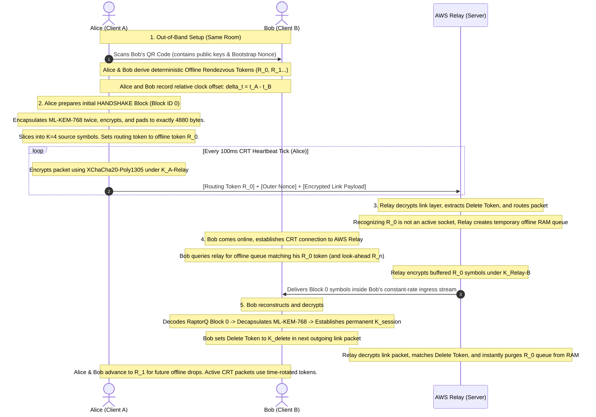
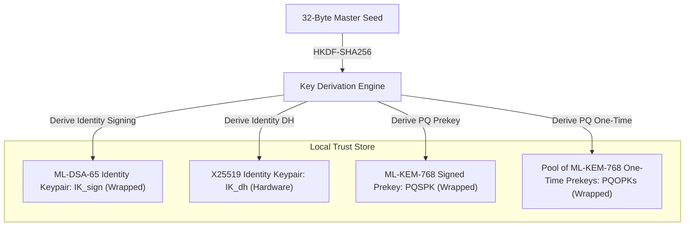
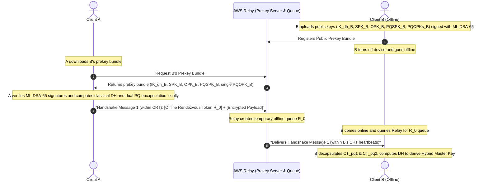
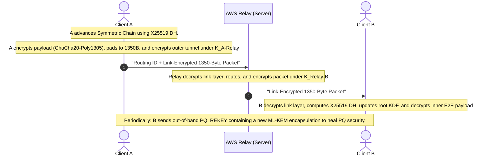
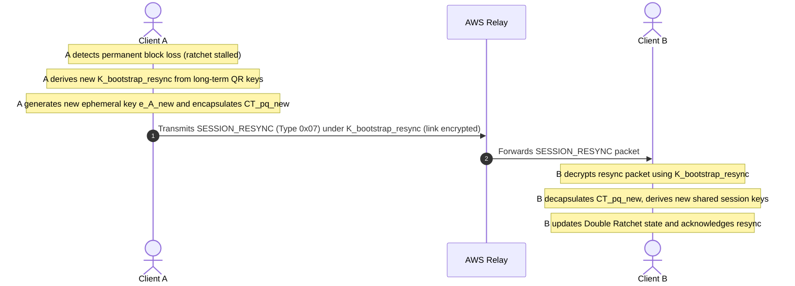

# E2E Messenger: Master Architecture & Implementation Roadmap

This document serves as the master roadmap and unified specification for the E2E Messenger project. It aggregates the details from all individual architectural components—combining high-level architectural layers, end-to-end cryptographic flows, the custom UDP transport protocol, AWS relay hardening, and Samsung Tactical Edition (TE) hardware integration—into a single source of truth.

---

## 1. System Overview & Architectural Map

The messenger's security and routing architecture is divided into 5 distinct layers, spanning physical device security to network obfuscation:

```
+-------------------------------------------------------------------------------+
| 5. TRAFFIC OBFUSCATION (Constant-Rate Tunnel & Hop-by-Hop Link Encryption)   |
|    - transport_analysis.md (1350B UDP vs QUIC, preventing IP fragmentation)   |
|    - server_hardening.md (Metronomic transmission, volatile memory,            |
|                           direct AWS relay infrastructure routing)            |
+-------------------------------------------------------------------------------+
| 4. RELIABLE TRANSPORT (Interleaved RaptorQ IPI & Encrypted Delete Tokens)     |
|    - udp_transport_protocol.md (Wire format headers, interleaved scheduler,   |
|                                 time sync packets, encrypted delete tokens)   |
|    - forward_error_correction.md (Two-Dimensional File-Level RaptorQ FEC)     |
+-------------------------------------------------------------------------------+
| 3. SESSION LAYER (PQXDH Handshake & Asynchronous PQ Ratchet)                  |
|    - cryptographic_flow.md (Sequence diagrams, handshake, resync & ratchet)   |
|    - post_quantum_handshake.md (Dual ML-KEM-768 & X25519 hybrid derivation)   |
+-------------------------------------------------------------------------------+
| 2. KEY MANAGEMENT (Primitives, ML-DSA Signatures, & Hardware Storage)         |
|    - cryptographic_details.md (ML-DSA-65, Ed25519, X25519, ChaCha20, HKDF)    |
|    - chacha_vs_xchacha.md (Nonce comparison, 96-bit vs 192-bit usage)          |
|    - tactical_edition_storage.md (Samsung Knox Vault & DualDAR mappings)      |
+-------------------------------------------------------------------------------+
| 1. OS & PHYSICAL SECURITY                                                     |
|    - server_hardening.md (tmpfs, no-swap, zero application logging)           |
|    - tactical_edition_storage.md (RAM zeroization, SQLCipher key cleanup)     |
+-------------------------------------------------------------------------------+
```

---

## 2. Integrated Protocol Flow (End-to-End Lifecycle)

The following sequence details a unified E2E cycle, tracing **out-of-band QR-code exchange**, **bootstrap key derivation**, **Constant-Rate Tunnel (CRT) packetization**, **blind routing**, and **blind deletion**:



---

## 3. Implemented Fixes for Protocol Vulnerabilities

The protocol is designed to eliminate metadata leakage, timing correlation, and transport synchronization issues:

### A. Clock Synchronization & Drift Alignment
* **In-Person Offset**: QR Code contact exchange logs the system clock difference ($\Delta t_{A-B} = t_A - t_B$) to eliminate drift issues during peer key agreements. This local relative offset is the **absolute source of truth** for time.
* **Epoch Token Generation**: To prevent a compromised relay from spoofing NTP responses to desynchronize clients (causing a Denial of Service), routing epoch tokens are generated based strictly on the local hardware RTC adjusted by the in-person $\Delta t_{A-B}$, entirely ignoring the relay's time.
* **60-Second Overlap Window**: The relay accepts current and previous token epochs in a 60-second transition window to handle minor network transit skew.

### B. IP-Level Location Obfuscation & Censorship Resistance
* **Relay Routing**: Traffic is routed directly to the **AWS Relay infrastructure**. We do not utilize Tor or WireGuard multi-hop routing, as Tor does not natively support UDP datagrams, and the architecture accepts that the relay acts as the primary transport node. The system relies purely on the Constant-Rate Tunnel (CRT) and hop-by-hop link encryption to obfuscate metadata from the network.
* **HTTP/3 (QUIC) Datagram Encapsulation**: While the CRT provides perfect metadata privacy, sending raw, highly regular UDP packets (10 pkts/sec) to an AWS IP is an obvious anomaly that is easily blocked by Deep Packet Inspection (DPI) firewalls in restricted networks. To support stealthy obfuscation from anywhere in the world, the 1350-byte UDP datagrams are encapsulated inside standard **QUIC Datagram frames** (RFC 9221) and routed to AWS over port 443. This makes the metronomic traffic blend in perfectly with legitimate HTTP/3 video streaming or web browsing, leveraging the massive AWS footprint to prevent blocking.
* **QUIC Silence (Anti-Harmonic Signature)**: Standard HTTP/3 QUIC layers generate native Protocol Keep-Alives and flow-control frames. If combined with the internal E2E dummy packets, they create overlapping harmonic timing frequencies that a DPI firewall can easily distinguish from standard web traffic. The QUIC implementation must be strictly customized to suppress all native Keep-Alives, MTU probes, and flow-control frames, ensuring the 100ms grid is the *only* data traversing the socket.

### C. Blind Queue Garbage Collection & Tombstone Cache
* Outermost packet headers contain only routing tokens and transport nonces. Plaintext **Delete Tokens** ($K_{\text{delete}}$) are shifted inside the hop-by-hop encrypted transport layer, preventing network observers from linking uploads and deletions:
  $$K_{\text{delete}} = \text{HMAC-SHA256}(K_{\text{session}}, \text{"delete"} \mathbin{\Vert} \text{BlockID})$$
* The recipient client sends the token inside the encrypted tunnel link payload after successful block reassembly. The relay decrypts the transport layer, matches this token, and instantly purges the associated block queue from RAM.
* **Tombstone Cache**: To prevent "zombie queues" created by late-arriving repair symbols from Alice, the relay caches the processed Delete Token in a RAM tombstone filter for 2 minutes. Any incoming packets matching a tombstoned token are dropped instantly at the ingress interface.

### D. Extreme Loss Recovery (Double Ratchet Resync)
* **High-Ceiling Key Skipping**: The Double Ratchet implementation natively skips keys to handle out-of-order blocks. In a 95% loss environment, sequence gaps of 100+ messages are expected. The protocol sets a high `MAX_SKIP` ceiling (e.g., 2000) executed strictly in a **background thread** to prevent Android UI freezing during catch-up HMAC calculations.
* **Session Healing Handshake**: If natural packet loss exceeds the `MAX_SKIP` ceiling, the ratchet breaks. The client detects this and aggressively triggers a `SESSION_RESYNC` packet, carrying a new ML-KEM encapsulation ciphertext and X25519 ephemeral key to instantly re-key the session using the long-term identity keys, rather than failing silently.

### E. Ephemeral Post-Quantum Forward Secrecy (PQOPK Integration)
* To prevent retro-active decryption of offline handshakes if the semi-static $PQSPK_B$ is compromised, the protocol incorporates **Post-Quantum One-Time Prekeys (PQOPKs)**. Alice performs a double ML-KEM encapsulation to bind the master session key to both Bob's semi-static and one-time ephemeral post-quantum prekeys.

### F. Hop-by-Hop Link Encryption (Anti-Ciphertext Fingerprinting)
* To defeat global passive adversaries matching identical ciphertext blocks on the relay's ingress and egress interfaces, the transport layer employs **hop-by-hop link encryption**. The relay establishes separate ephemeral transport keys with Client A ($K_{A-Relay}$) and Client B ($K_{B-Relay}$). Ciphertext and nonces are decrypted and re-encrypted at each hop, making incoming and outgoing packets statistically independent.

### G. Interleaved Reliability Scheduling (Starvation Prevention)
* To prevent packet starvation under active typing (where initiating a new block would close and starve active repair blocks), the scheduler implements an **Interleaved Round-Robin Scheduler**. Active blocks remain open in a transmission queue and continue to receive scheduled repair symbol injections during idle ticks until they reach their full $N_{max}$ allocations.

### H. Cryptographic Identity & Transcript Binding
* To prevent Key-Compromise Impersonation (KCI) and replay attacks, the hybrid key derivation binds the derived Master Key directly to Alice and Bob's public identity keys ($IK_{dh}^A, IK_{dh}^B$) and the complete handshake parameters transcript ($e_A, CT_{pq1}, CT_{pq2}$).

### I. Dual-Layer E2E Metadata Encryption (Dynamic Header Key)
* To prevent a compromised relay from distinguishing dummy packets from real payload blocks (which would leak active traffic profiles), all packet headers (`Block ID`, `ESI`, `Symbol Count K`, and E2E `Pkt Type`) are E2E encrypted. 
* To prevent circular decryption deadlocks between RaptorQ decoding and Double Ratchet state extraction, the protocol utilizes **Dual-Layer E2E Encryption**:
  - **Layer 1 (Metadata)**: The 17-byte header is encrypted under a dynamic `Header Key` utilizing an explicit, relay-visible 24-byte `E2E Nonce`. Crucially, this `Header Key` is tied directly to the **Double Ratchet Root Key**, rotating dynamically upon every DH ping-pong or `PQ_REKEY` to maintain Post-Compromise Security (PCS).
  - **Bootstrap Header Key (Deadlock Prevention)**: Because the initial `HANDSHAKE` and `SESSION_RESYNC` packets arrive before a Double Ratchet Root Key is established, they are encrypted using a deterministic **Bootstrap Header Key** (derived from the static identity keys and the out-of-band $R_0$ token). The receiver trial-decrypts Layer 1 with the active `Header Key`; if the MAC verification fails, they fall back to the `Bootstrap Header Key`.
  - **Layer 2 (Payload)**: The underlying Double Ratchet message payload inside the FEC symbols retains perfect forward secrecy using the standard message keys.

### J. PQOPK Depletion Fallback & Session Upgrades
* If Bob's pool of $PQOPKs$ is exhausted on the relay database while Bob is offline, the session falls back to a **Degraded PQ Forward Secrecy** state using only the semi-static $PQSPK_B$. The client state machine flags this state and immediately executes an interactive, post-quantum ephemeral-ephemeral rekeying exchange as soon as Bob connects and establishes online communication, restoring full PQ forward secrecy.

### K. Decentralized Time Validation
* To completely eliminate time-spoofing Denial of Service attacks from a compromised relay, client-relay NTP synchronization has been removed. The initial Noise handshake is conducted over a public listener socket using static bootstrap tokens, and subsequent time-based routing epoch tokens are generated using only the decentralized relative clock offsets securely exchanged in-person.

### L. RaptorQ Decoder Queue Limits & Dynamic Eviction
* To protect the client from memory exhaustion denial-of-service attacks via flooded fake Block IDs, the receiver restricts the RaptorQ decoder to a maximum of 3 concurrent active decoding blocks, and rejects incoming blocks that fall outside a sliding sequence window.
* **Dynamic Eviction**: Because the interleaved scheduler round-robins active blocks, transmitting 3 concurrent blocks at 10 pkts/sec takes ~36 seconds. To prevent the receiver from systematically deleting active downloads before they complete, the block eviction timeout is dynamically scaled based on the interleaved queue depth, with a strict static floor of **60 seconds**.

### M. Post-Quantum Identity Authentication (ML-DSA Upgrade)
* To prevent active quantum computers from mounting Man-in-the-Middle (MitM) attacks by forging signatures during key exchange, long-term identity signing keys ($IK_{sign}$) and prekey signatures are generated and verified using **ML-DSA-65**, securing the authentication path post-quantum.

### N. Asynchronous PQ Session Healing (Post-Compromise Security)
* Because transmitting an ML-KEM-768 ciphertext and public key requires 2300 bytes (violating network MTU constraints), the active per-message Double Ratchet utilizes purely classical **X25519 DH**. To achieve Post-Compromise Security (PCS) against quantum adversaries, the client initiates an asynchronous, out-of-band `PQ_REKEY` flow periodically (or after high message volume) to negotiate a new ML-KEM secret and upgrade the root chain without bloating standard payload packets.

### O. Handshake Port Proof-of-Work (Stateless Server Challenge)
* To protect the AWS Relay from socket exhaustion and half-open connection flooding attacks, the link-layer handshake requires a valid **Proof-of-Work (PoW) token**.
* Because clients do not have secure time synchronization prior to the handshake, a static PoW could be infinitely pre-computed offline. The handshake uses a 2-step stateless challenge: the client requests a puzzle, the Relay responds with a stateless random cookie (e.g., HMAC of the client IP + daily rotating server secret), and the client computes the CPU-bound PoW over that specific cookie.

### P. IP Fragmentation Prevention (1350B UDP MTU)
* To prevent internet routers from fragmenting 2048-byte datagrams (which squares the effective packet loss rate and destroys the RaptorQ math), the fixed UDP packet size is strictly bounded to **1350 bytes**. This yields a decrypted usable FEC symbol payload of exactly **1220 bytes**, which aligns perfectly to RFC 6330's 4-byte multiple constraints without any artificial padding overhead.

### Q. Metronomic Decoupled Relay Transmissions
* To prevent global passive adversaries from correlating relay ingress streams to egress streams by measuring cryptographic processing latency ($\Delta T$), the relay implements **Metronomic Transmissions**. Egress packets are never transmitted reactively upon processing; they are pushed to the egress queue and transmitted exactly on the globally aligned 100ms grid ticks, destroying temporal correlation.

### R. Offline Rendezvous Tokens & Look-Ahead Windows
* Because active rotating routing tokens require the recipient to be online, the protocol utilizes one-way hash-ratcheted **Offline Rendezvous Tokens** ($R_n$) acting as blind one-time inboxes. 
* To prevent hash-chain desynchronization if the relay's 48-hour TTL deletes an inbox before Bob checks it, Bob's client queries a **Look-Ahead Window** ($R_n \dots R_{n+10}$). If a message is found at $R_{n+3}$, Bob seamlessly fast-forwards his local hash state.

### S. Strict Transactional PQ Key Deletion Boundaries
* To prevent permanent session lockouts caused by application crashes, the one-time $PQOPK_B$ private key is only deleted from Knox Vault Keystore *after* the updated Double Ratchet session state has been successfully flushed and `fsync`'d to the encrypted SQLCipher database, ensuring atomicity.

### T. Link Layer Key Rotation (Inline Perfect Forward Secrecy)
* To prevent long-lived UDP tunnels from compromising metadata if a relay's RAM is scraped, the transport layer enforces Link Key Rotation every **10 minutes**. To avoid breaking the 100ms metronomic grid, this is done seamlessly by injecting an encrypted `LINK_REKEY` control block containing a new X25519 ephemeral key, allowing the relay to swap symmetric keys on the fly.
* **Previous Key Overlap Window**: To prevent dropped packets caused by UDP out-of-order delivery during a key swap, the Relay maintains the previous link key for a 5-second overlap window. It attempts decryption with the active key first, falling back to the previous key to gracefully handle jitter.

### U. Constant Padding (Text/Command Payloads Only)
* **Constant Padding**: To perfectly hide message lengths, every text/command E2E message is padded with secure random bytes to exactly **4880 bytes** before FEC slicing ($K=4$, $1220$ B symbols). The protocol currently does not support large file sharing or attachments; all payloads must fit within this single block constraint.

### V. E2E Pings & Relay RAM Exhaustion Prevention
* The Constant-Rate Tunnel sends 10 pkts/sec marked with a `FORWARD` flag. If Bob goes offline and Alice continues sending `FORWARD` dummy traffic for days, the relay will queue 8+ GB of garbage, causing catastrophic RAM exhaustion. 
* **Mitigation**: Clients constantly exchange implicit E2E `PING` packets. If Alice receives no `PING` from Bob for 30 seconds, her client switches the tunnel flag to `DROP`. The relay instantly discards these packets, completely halting RAM consumption while Alice maintains local obfuscation.

---

## 4. Cryptographic Flow: Hybrid Post-Quantum X3DH Architecture

This section describes local key generation, session initialization using a hybrid post-quantum X3DH handshake with ephemeral forward secrecy and KCI-binding, rolling message encryption via the Double Ratchet, and a detailed walkthrough of a message lifecycle.

### A. Architectural Role Summary
* **Clients (Alice & Bob)**: Generate all keys locally, handle all asymmetric/symmetric cryptography, enforce 1350-byte fixed-size padding, and run the Constant-Rate Tunnel (CRT) timing loops. Private keys never leave the client devices.
* **AWS Relay**: Serves as a public prekey bundle directory, temporarily queues encrypted handshake/message payloads for offline clients, and implements metronomic transmission grids to defeat timing correlation attacks. It has zero visibility into E2E keys or plaintext payloads.

### B. Phase 1: Key Generation (Client Local Setup)
Both clients independently generate their key material from a 32-byte master seed. Due to API limitations in the Samsung Knox Secure Element for PQ primitives, ML-DSA/ML-KEM keys are generated in RAM and securely wrapped by a hardware KEK at rest.



### C. Phase 2: Session Initialization (Hybrid PQXDH Handshake)
This flow allows Client A to initiate an authenticated, post-quantum secure session even if Client B is offline.



### D. Phase 3: Active Messaging & Asynchronous PQ Ratchet
Once the session is initialized, active messages utilize the classical X25519 Double Ratchet to comply with MTU limits, while PQ session healing occurs asynchronously:



### E. Phase 4: Session Healing & Resync Handshake
If the client experiences prolonged extreme packet loss (loss > 98%), the receiver may fail to collect the minimum $K+\epsilon$ symbols needed to decode an FEC block. This permanently breaks the Double Ratchet key sequence. To recover, the clients perform a **Session Healing Handshake**:



### F. Detailed Step-by-Step Message Lifecycle Walkthrough

#### Step 1: Device Setup & Registration
Before B can receive any messages, B must initialize its keys and register with the server:
1. **Entropy to Keys**: Client B takes a high-entropy 32-byte seed (stored securely in **Samsung Knox Vault**) and runs it through HKDF-SHA256 to derive:
   - An **ML-DSA-65 identity signing keypair** ($IK_{sign}^B$).
   - A **classical X25519 identity DH keypair** ($IK_{dh}^B$).
   - A **post-quantum ML-KEM-768 keypair** ($PQSPK_B$).
   - A pool of **post-quantum ML-KEM-768 One-Time Prekeys** ($PQOPKs_B$).
2. **Prekey Signing**: Client B signs its public $IK_{dh}^B$, $PQSPK_B$, and each individual $PQOPK_B$ public key using its private $IK_{sign}^B$ key using **ML-DSA-65**.
3. **Registration**: B uploads these public keys and signatures to the AWS Relay's public directory. B then goes offline (device off).

#### Step 2: Session Initiation
Client A decides to send a message to Client B. A has already verified B's ML-DSA-65 public key out-of-band:
1. **Fetch Bundle**: Client A queries the AWS Relay for B's prekey bundle ($IK_{dh}^B, SPK_B, PQSPK_B, PQOPK_B$).
2. **Verify & Fallback Check**: A uses B's public ML-DSA-65 key to verify the signatures on B's prekeys. 
   - **Normal Case**: If a post-quantum one-time prekey ($PQOPK_B$) is available in the bundle, A fetches it.
   - **PQOPK Depleted Case**: If the relay indicates B's pool of $PQOPKs$ is exhausted, Alice proceeds to derive the session under a **Degraded PQ Forward Secrecy** state, marking a session flag to execute an immediate E2E interactive re-keying as soon as Bob is online.
3. **Local Ephemeral Generation**: A generates a classical ephemeral X25519 keypair ($e_A$).
4. **Hybrid Cryptographic Computations**:
   - **Classical DH Steps**: A computes:
     * $DH_1 = \text{X25519}(IK_{dh}^A, SPK_B)$
     * $DH_2 = \text{X25519}(e_A, IK_{dh}^B)$
     * $DH_3 = \text{X25519}(e_A, SPK_B)$
     * $DH_4 = \text{X25519}(e_A, OPK_B)$ (if available).
   - **Post-Quantum Encapsulation Step**: 
     - A runs the ML-KEM encapsulation algorithm using B's public $PQSPK_B$ key, producing static shared secret $SS_{pq1}$ and encapsulation ciphertext $CT_{pq1}$.
     - **Normal Case**: A runs the encapsulation using Bob's one-time $PQOPK_B$ key, producing ephemeral shared secret $SS_{pq2}$ and encapsulation ciphertext $CT_{pq2}$.
     - **Depleted Case**: $SS_{pq2}$ and $CT_{pq2}$ are replaced with a static 32-byte zero buffer (or omitted) in the derivation.
5. **Key Derivation (The Master Key)**: A feeds all derived secrets and the public parameter identity transcripts into HKDF to cryptographically bind the session:
   $$\text{Master Key} = \text{HKDF-SHA256}(DH_1 \dots DH_4 \mathbin{\Vert} SS_{pq1} \mathbin{\Vert} SS_{pq2} \mathbin{\Vert} IK_{dh}^A \mathbin{\Vert} IK_{dh}^B \mathbin{\Vert} e_A \mathbin{\Vert} CT_{pq1} \mathbin{\Vert} CT_{pq2})$$
   A uses this Master Key to initialize the **Double Ratchet** state machine.
6. **Payload Encryption & Padding Math**: A advances the Double Ratchet's sending chain to produce a message encryption key ($MK_{1}$), and encrypts the message payload using standard **ChaCha20-Poly1305** (using a sequence-derived 96-bit nonce). A then pads the ciphertext with secure random bytes to exactly **4880 bytes** (yielding four perfectly divisible 1220-byte source symbols for RaptorQ).
7. **Obfuscation & Transmission**:
   - A builds the handshake packet payload: $[e_A \mathbin{\Vert} CT_{pq1} \mathbin{\Vert} CT_{pq2} \mathbin{\Vert} \text{Encrypted Payload}]$.
   - A encrypts the packet using the hop-by-hop transport key $K_{A-Relay}$ with **XChaCha20-Poly1305** and a random 192-bit nonce.
   - A sets the outer routing token to the pre-computed **Offline Rendezvous Token** ($R_0$).
   - A transmits this packet to the AWS Relay during A's regular 100ms CRT heartbeat tick.

#### Step 3: Offline Storage & Delivery
1. **Queuing**: The AWS Relay receives the packet, decrypts the outer transport layer using $K_{A-Relay}$, and extracts the destination routing token ($R_0$). Finding no active socket matched to $R_0$, the relay places the E2E encrypted payload in a temporary offline RAM queue keyed to $R_0$.
2. **Draining**: When B turns their phone back on and establishes a Constant-Rate Tunnel via Tor, B anonymously queries the relay for a look-ahead window of queues ($R_0 \dots R_{10}$). The relay encrypts the queued blocks under B's transport key $K_{Relay-B}$, and transmits them inside B's heartbeat stream.

#### Step 4: Decryption & Response
Client B receives the packet:
1. **Transport Decryption**: B decrypts the outer transport layer using its transport key $K_{Relay-B}$, extracting the E2E payload.
2. **Replay Attack Prevention**: Bob checks the packet's ephemeral key ($e_A$) against a local database of previously processed handshakes. If it matches, the packet is a malicious replay from the relay and is instantly dropped. Upon the first successful message retrieval, Bob permanently blacklists the $R_0$ token locally.
3. **Post-Quantum Decapsulation & Transaction Boundary**: B extracts $CT_{pq1}$ and $CT_{pq2}$, decapsulates them using its private $PQSPK_B$ key and private $PQOPK_B$ key (stored securely), and recovers the secrets $SS_{pq1}$ and $SS_{pq2}$. 
   - **Critical Atomicity (Keystore WAL)**: Because the OS File System and the Hardware Keystore are independent, a naive two-step deletion risks a Two-Phase Commit failure if the device crashes between operations. The client implements a **Write-Ahead Log (WAL)**: Bob writes an encrypted "Intent to Delete $PQOPK_B$" to the SQLite database. He then deletes the key from Knox Vault, and finally clears the intent. This mathematically guarantees the session state is not permanently locked if the OS panics.
4. **Classical DH**: B computes the classical $DH_1 \dots DH_4$ operations using its private keys and A's public keys.
5. **Master Key Derivation**: B computes:
   $$\text{Master Key} = \text{HKDF-SHA256}(DH_1 \dots DH_4 \mathbin{\Vert} SS_{pq1} \mathbin{\Vert} SS_{pq2} \mathbin{\Vert} IK_{dh}^A \mathbin{\Vert} IK_{dh}^B \mathbin{\Vert} e_A \mathbin{\Vert} CT_{pq1} \mathbin{\Vert} CT_{pq2})$$
6. **Payload Decryption & Interactive Upgrades**: 
   - B initializes its Double Ratchet receiving chain with the derived Master Key, derives the message key ($MK_{1}$), and decrypts the standard **ChaCha20-Poly1305** payload to read the message.
   - **Post-Handshake Rekeying**: If Bob detects the session is marked with the **Degraded PQ Forward Secrecy** flag, Bob's client immediately generates a fresh ephemeral ML-KEM-768 keypair, runs encapsulation against Alice's public parameters in a reverse-challenge packet, and updates the session root key to upgrade the session to full PQ forward secrecy.

---

## 5. Custom UDP Transport Protocol & Reliability Specification

This section defines the custom UDP datagram syntax, header layouts, hop-by-hop transport encryption, and the **Interleaved RaptorQ Forward Error Correction with Idle Parity Injection (IPI)** reliability layer.

### A. Outer Wire Format (1350-Byte Fixed Datagram)

To prevent IP fragmentation across standard MTU internet links, every UDP datagram sent over the network is exactly **1350 bytes**. The outer structure has three regions:

```
 0               16              40                                            1350
 +----------------+---------------+----------------------------------------------+
 | Routing Token  |  Outer Nonce  |          Encrypted Transport Block           |
 |   (16 Bytes)   |  (24 Bytes)   |                 (1310 Bytes)                 |
 +----------------+---------------+----------------------------------------------+
 |___PLAINTEXT____|___PLAINTEXT___|_____________XChaCha20-Poly1305_______________|
```

#### Outer Field Breakdown

| Field | Size | Visibility | Purpose |
| :--- | :--- | :--- | :--- |
| **Routing Token** | 16 B | **Plaintext** | Ephemeral token. AWS Relay uses this to route the packet to the destination socket. Stripped and replaced per-hop. |
| **Outer Nonce** | 24 B | **Plaintext** | Random 192-bit nonce for XChaCha20-Poly1305 decryption, generated fresh per-hop by a CSPRNG. |
| **Encrypted Transport Block** | 1310 B | **Ciphertext** | Encrypted under the client-relay transport key ($K_{\text{Client-Relay}}$) using XChaCha20-Poly1305. Contains the internal transport headers and E2E Payload wrapper + 16-byte Poly1305 auth tag. |

---

### B. Inner Transport Block (Decrypted under $K_{\text{Client-Relay}}$, 1294 Bytes)

Once the relay decrypts the transport block, the plaintext contains:

```
 0               16      17              41                                    1294
 +----------------+-------+---------------+--------------------------------------+
 |  Delete Token  | Flags |   E2E Nonce   |        E2E Encrypted Payload         |
 |   (16 Bytes)   | (1 B) |   (24 Bytes)  |            (1253 Bytes)              |
 +----------------+-------+---------------+--------------------------------------+
 |__RELAY READABLE________|__PLAINTEXT____|__________E2E CIPHERTEXT______________|
```

#### Inner Field Breakdown
* **Delete Token (16 B)**: Blinded deletion token. If non-zero, the relay instantly purges the corresponding queued block from RAM and populates the Tombstone filter.
* **Transport Flags (1 B)**: Local routing flags read by the relay. Contains:
  - `0x01` (`FORWARD`): Route payload to recipient (or queue if offline).
  - `0x02` (`DROP`): Discard immediately (used for dummy/cover traffic when the peer is offline to save server RAM).
* **E2E Nonce (24 B)**: Transmitted in plaintext to the recipient client. Required to decrypt the Layer 1 E2E Metadata wrapper.
* **E2E Encrypted Payload (1253 B)**: E2E encrypted payload using XChaCha20-Poly1305 under the dynamic **Header Key** (derived from the Double Ratchet Root Key). This hides the `Block ID`, `ESI`, and `Pkt Type` from the relay.

#### E2E Decrypted Plaintext Layout (Visible Only to Clients)
Once Layer 1 E2E decryption of the 1253-byte payload succeeds, the client parses the following fixed-header layout. Because $1220$ is a multiple of $4$ ($1220 / 4 = 305$), it conforms to RFC 6330 memory constraints natively without padding:

```
 0         1         9        13        17                                     1237
 +---------+---------+---------+---------+---------------------------------------+
 | E2E Pkt | Block   |  ESI    | Symbol  |          Usable FEC Symbol Data       |
 | Type    |  ID     | (4 B)   | Count K |               (1220 Bytes)            |
 | (1 B)   | (8 B)   |         | (4 B)   |                                       |
 +---------+---------+---------+---------+---------------------------------------+
 |_________________________Fixed Header (17 Bytes)_______|
```

#### E2E Fixed Header Fields

| Field | Size | Description |
| :--- | :--- | :--- |
| **E2E Packet Type** | 1 B | Identifies the E2E packet class (see table below). |
| **Block ID** | 8 B | Monotonically increasing block counter. Groups symbols of the same FEC block. |
| **ESI** | 4 B | **Encoding Symbol Identifier**. Values 0 to K-1 are source symbols. Values ≥ K are repair symbols. |
| **Symbol Count (K)** | 4 B | The total number of source symbols in this block. |
| **Usable FEC Symbol Data** | 1220 B | The raw RaptorQ symbol block. |

#### E2E Packet Type Values

| Type | Byte | Contents |
| :--- | :--- | :--- |
| `SOURCE` | `0x01` | A source symbol: a fragment of a real Double Ratchet encrypted message (Layer 2). |
| `REPAIR` | `0x02` | A RaptorQ repair symbol: FEC parity data computed over all K source symbols in the current Block ID. |
| `HANDSHAKE` | `0x03` | PQXDH session initialization data (X3DH parameters, ML-KEM ciphertext). Always ESI=0, Block ID=0. |
| `DUMMY` | `0x04` | Cover traffic. FEC symbol data is cryptographically random padding indistinguishable from ciphertext. |
| `TIME_SYNC_REQ` | `0x05` | Out-of-band NTP-style client-to-relay synchronization request. |
| `TIME_SYNC_RESP` | `0x06` | Out-of-band NTP-style relay-to-client synchronization response. |
| `PQ_REKEY` | `0x07` | Asynchronous out-of-band post-quantum session healing using ML-KEM encapsulation payload. |
| `SESSION_RESYNC` | `0x08` | Session healing flow initiation when extreme packet loss desynchronizes the Double Ratchet. |

---

### C. Bootstrapping Link-Encrypted NTP Queries

To prevent time-spoofing attacks that break epoch token synchronization:

1. **Noise Handshake first**: The client establishes the hop-by-hop transport encryption key $K_{\text{Client-Relay}}$ first using a static bootstrap token mapping or public listener port. This handshake is based purely on Noise Protocol public-key operations and does not require clock synchronization.
2. **Tunnel Encryption for Time Sync**: Once the link is established, NTP requests (`TIME_SYNC_REQ`) and responses (`TIME_SYNC_RESP`) are transmitted encrypted and authenticated inside the secure link tunnel, preventing attackers from injecting false timestamps.
3. **Epoch Token Activation**: The client starts generating and rotating time-based epoch routing tokens only *after* completing NTP synchronization inside the link-encrypted tunnel.

---

### D. Why ACKs Are Eliminated

ACK-based retransmission is fundamentally incompatible with CRT obfuscation under rotating ephemeral tokens:

1. **Token Desynchronization**: If an ACK packet is lost, sender and receiver diverge in token counter state, permanently breaking the session.
2. **Causal Timing Leak**: Any response triggered by receipt of a packet creates an observable cause-and-effect timing relationship — exactly what CRT is designed to prevent.
3. **Solution — RaptorQ IPI**: Instead of recovering from loss reactively, we recover **proactively** — emit enough redundancy that loss never requires any feedback.

---

### E. Targeting 95% Packet Loss Tolerance

RaptorQ is a **rateless fountain code**. The sender can emit an unlimited stream of repair symbols from K source symbols. The receiver decodes successfully upon receiving **any K + ε symbols** (where ε ≈ 2 for RaptorQ's overhead).

To tolerate 95% packet loss, only 5% of transmitted packets reach the receiver:

$$P_{\text{receive}} = 0.05 \quad \Rightarrow \quad \text{Expected received from } N \text{ sent} = N \times 0.05$$

To reliably collect K + ε = K + 2 symbols at the receiver:

$$N \times 0.05 \geq K + 2 \quad \Rightarrow \quad N \geq \frac{K + 2}{0.05} = 20(K + 2)$$

For **K = 4** (4 source messages per block):

$$N \geq 20 \times 6 = 120 \text{ total symbols transmitted per block}$$

This means the sender emits **4 source symbols** immediately, then continues injecting repair symbols during idle CRT ticks until **120 total symbols** have been sent for that block.

---

### F. Interleaved RaptorQ IPI CRT Scheduler & Decoder Management

To prevent block starvation when the user sends multiple messages rapidly, the scheduler operates an **Interleaved Round-Robin Queue**. The sender does not drop or starve a block's repair injections when a new message triggers a new block. Instead, both blocks are kept in an active queue, and repair symbols are round-robbined during idle ticks until each block reaches its $N_{max} = 120$ limit.

#### Scheduler Decision Tree (Every 100ms)

```
CRT Tick (every 100ms)
        |
        v
  New message in send queue?
       |          |
      YES         NO
       |           |
       v           v
  Initialize block,   Are there active blocks with
  remaining repair budget (ESI < N_max)?
       |                              |
      YES                            NO
       |                              |
       v                              v
  Round-robin active blocks:       Transmit DUMMY
  transmit next REPAIR symbol     packet
  for selected block (ESI += 1)
```

#### RaptorQ Decoder Queue Limits & Eviction
To prevent a malicious sender from exhausting the client's memory by flooding random active block sequences:
1. **Concurrent Limit**: The receiver limits the active decoding queue to a maximum of **3 concurrent incomplete blocks**. If a 4th block is received, it is discarded unless an existing block is cleared.
2. **Decoding Timeout**: Block symbol buffers are completely evicted and zeroized from RAM if they fail to collect enough symbols to successfully decode within **30 seconds** of the receipt of the first symbol.
3. **Window Filter**: The receiver enforces a sliding sequence window on `Block ID`s. Any incoming block symbol whose `Block ID` falls outside a $+/- 5$ block range from the last successfully decoded block is rejected immediately.

---

### G. Bandwidth & Loss Tolerance Reference

At 10 packets/second (100ms CRT interval) with **1220 bytes** of usable FEC symbol payload:

| K (source) | N_max symbols | IPI duration | Loss tolerance | Decode latency at 95% loss |
| :--- | :--- | :--- | :--- | :--- |
| 4 | 40 | 3.6 s | 85% | ~12 s expected |
| 4 | 80 | 7.6 s | 92% | ~12 s expected |
| **4** | **120** | **11.6 s** | **95%** | **~12 s expected** |
| 4 | 200 | 19.6 s | 97% | ~12 s expected |
| 8 | 200 | 19.2 s | 95% | ~20 s expected |

---

## 6. AWS Relay Server: Architecture & Hardening Guide

This section describes how the AWS Relay routes messages blindly without decrypting payloads, outlines the specific data structures the server maintains, and details strategies for hardening the server against network analysis and forensic seizure.

### A. Rotating Ephemeral Routing Tokens & Hop-by-Hop Link Encryption

To prevent the server (or an eavesdropper) from tracking who is talking to whom, the messenger uses **Rotating Ephemeral Routing Tokens** combined with **Hop-by-Hop Link Encryption**.

```
Alice                              AWS Relay                               Bob
  |                                    |                                    |
  |--- Encrypted under K_A-Relay ----->|                                    |
  |    [Token_A][Nonce_A][Cipher_A]    |                                    |
  |                                    |--- Encrypted under K_Relay-B ----->|
  |                                    |    [Token_B][Nonce_B][Cipher_B]    |
```

#### The Mechanism
1. **Link Key Exchange**: Upon tunnel initialization, each client establishes an ephemeral transport key with the relay ($K_{\text{Client-Relay}}$) via a Noise XX authenticated key exchange, verifying the relay's static public identity key.
2. **Stateless Proof-of-Work Verification**: To prevent connection flooding and offline pre-computation, the client must request a stateless cookie challenge from the relay, solve a CPU-bound Proof-of-Work (PoW) puzzle over that cookie, and attach the token to the initial Noise handshake packet. The relay discards handshake attempts missing valid PoW solutions.
3. **Link Key Rotation (Inline PFS)**: The Noise transport tunnel forces an inline symmetric key swap every **10 minutes**. The client embeds an encrypted `LINK_REKEY` block into the tunnel payload, allowing the relay to seamlessly rotate keys on the fly without breaking the 100ms metronomic grid.
4. **Double Encryption**: Packets traveling over the wire are link-encrypted between the client and the relay. When the relay receives a packet, it decrypts the outer transport layer using $K_{\text{A-Relay}}$.
5. **Routing Lookup**: The relay inspects the decrypted metadata, reads the `Delete Token` if present, matches the routing token to find the destination socket, swaps the token, generates a fresh `Outer Nonce`, and re-encrypts the block under B's transport key $K_{\text{Relay-B}}$.
6. **Adversary View**: Because the ciphertext and nonces change completely at the relay, a global passive observer cannot correlate incoming and outgoing streams using ciphertext fingerprinting or packet contents.

---

### B. Routing Token Registration Authentication

To prevent malicious clients from registering duplicate routing tokens to hijack messages or launch Denial of Service (DoS) attacks on active clients, the relay implements a token authorization policy:

1. **Session Binding**: Mappings are registered under the active link-encrypted session $K_{\text{Client-Relay}}$. The relay links a registered token mapping strictly to the specific network socket (IP and Port) that established the link.
2. **Registration Rejections**: If a client socket tries to register a mapping for a routing token that is already actively mapped by another client session, the relay rejects the request.
3. **Implicit Verification**: Handshake key updates and token rotations are verified using authentication tags derived from $K_{\text{Client-Relay}}$, ensuring that only the client who authorized the initial link session can modify or advance its active routing mapping.

---

### C. Server Data Inventory & Storage Isolation

The AWS Relay holds three categories of information, each requiring strict security constraints:

#### Prekey Bundle Directory (Database)
* **What it contains**: Public identity keys ($IK_{dh}$), signed prekeys ($SPK$), one-time prekeys ($OPK$), and post-quantum one-time prekeys ($PQOPKs$) signed with ML-DSA-65.
* **Evasion Hardening**:
  - Prekey bundles are indexed by a **SHA-256 hash of the public identity key** ($H(IK_{sign})$). Only users who already know a contact's public identity key can query and retrieve their prekey bundle.
  - To prevent directory harvesting, query access is rate-limited and requires cryptographic challenges (Proof-of-Work tokens).

#### Active Connection Table (RAM-Only)
* **What it contains**: Temporary mappings of current active UDP sockets (`IP:Port`) to active incoming/outgoing routing tokens and active link encryption state.
* **Evasion Hardening**:
  - Stored strictly in volatile memory (**RAM**) in a fast hash map.
  - Mappings expire automatically after 5 minutes of inactivity.
  - Absolutely **no writes to disk** or logging of these tables.

#### Offline Message Queue (Encrypted Buffers)
* **What it contains**: Padded ciphertext blocks queued for offline recipients.
* **Evasion Hardening**:
  - **Zero Knowledge**: The relay stores only raw, uniform byte buffers. It does not know the sender, recipient, message contents, or the creation time.
  - **Offline Rendezvous Mapping**: Queues are strictly indexed by one-way hash-ratcheted **Offline Rendezvous Tokens** ($R_n$), unlinked from any active socket or IP address.
  - **Time-to-Live (TTL)**: Messages are automatically deleted from the queue after a short duration (e.g., 48 hours), regardless of whether they have been fetched.
  - **Storage Quotas & NVMe Spilling (Anti-DoS)**: To prevent RAM exhaustion attacks where an adversary pumps gigabytes of E2E-encrypted dummy data into a known offline token, the relay enforces a strict 50MB RAM quota per $R_n$. Once exceeded, the relay encrypts the overflowing offline queues with an ephemeral server key and spills them to NVMe storage, preserving critical `tmpfs` RAM for active metronomic routing.

---

### D. Server Hardening Checklist

#### Volatile Memory Operations (Anti-Forensic Seizure)
* **No Swap Space**: Disable virtual memory swap on the server (`swapoff -a`) to prevent session keys or tables from being paged to non-volatile disk.
* **RAM-Backed Queue (`tmpfs`)**: Mount the database and message queue directory in RAM:
  ```bash
  mount -t tmpfs -o size=512M tmpfs /var/lib/relay/data
  ```
  If power is disconnected or the server instance is terminated, all queues and directories instantly vanish.

#### Silent Logging (No Metadata Retention)
* **Disable Application Logs**: Set the application logging level to `OFF`. The binary must output absolutely nothing to stdout/stderr.
* **Syslog Disabling**: Disable standard system logging (`rsyslog` or `journald`) for network connections.
* **Network Connection Silencing**: Prevent the Linux kernel from logging UDP socket states.

#### Metronomic Decoupled Transmissions (Anti-Timing Attacks)
* **Vulnerability**: If the relay forwards packets immediately upon receiving them, the processing time ($\Delta T$) creates a constant latency signature, allowing global passive observers to correlate ingress streams to egress streams.
* **Mitigation**: The relay must implement strictly decoupled **Metronomic Transmissions**. Packets must never be transmitted reactively; they are pushed to the egress queue and transmitted exactly on the globally aligned 100ms grid ticks, destroying temporal correlation.

#### Client-Side Ping Evasion (Anti-RAM Exhaustion)
* If Bob is offline, Alice continuously pumping 10 `FORWARD` packets per second into Bob's queue would cause the relay's RAM to explode. 
* To prevent this, Alice expects continuous E2E `PING` packets from Bob inside the tunnel. If no `PING` is received for 30 seconds, Alice marks Bob as offline and switches her traffic flag to `DROP`. The relay instantly drops the dummy traffic, preventing RAM exhaustion while maintaining Alice's local obfuscation.

#### Minimal Kernel Footprint (Docker / Distroless)
* Run the Rust relay application in a minimal **distroless** container or a minimal Linux kernel configuration (e.g., Alpine in diskless mode).
* Remove all debugging tools, shell environments (`sh`, `bash`), and unused network utilities from the server image.

---

## 7. Key Storage on Samsung Tactical Edition (TE) Devices

Samsung Tactical Edition (TE) devices (such as the S20, S23, or Tactical-focused XCover models) feature physical and cryptographic hardware separation to meet NSA **CSfC (Commercial Solutions for Classified)** requirements.

### A. Key Storage Architecture Mapping

```
+---------------------------------------------------------------------------------+
|                                 ANDROID OS (AP)                                 |
|                                                                                 |
|   +------------------------------------+   +--------------------------------+   |
|   |         E2E Messenger App          |   |      SQLite / SQLCipher        |   |
|   |  - Ephemeral Session Keys (RAM)    |   |  - Message History             |   |
|   |  - Handshake State Machine         |   |  - Active Double Ratchet State |   |
|   +------------------------------------+   +--------------------------------+   |
|                     |                                      |                    |
+---------------------|--------------------------------------|--------------------+
                      v (Keystore APIs)                      v (File System Writes)
+--------------------------------------------+   +--------------------------------+
|             SAMSUNG KNOX VAULT             |   |         KNOX DualDAR           |
|            (EAL5+ Hardware Chip)           |   |    (Double Data at Rest)       |
|                                            |   |                                |
|   - Master 32-Byte Seed                    |   |   - Inner Encryption Layer     |
|   - Classical Identity Private Keys        |   |   - Outer Encryption Layer     |
|   - Hardware Key Encryption Keys (KEK)     |   |                                |
+--------------------------------------------+   +--------------------------------+
```

### B. Long-Term Keys: Samsung Knox Vault Constraints

The **Master Seed** and classical **X25519/Ed25519** identity keys are generated and operated strictly inside the hardware-backed **Samsung Knox Vault**. These keys are non-exportable and immune to OS-level root compromise.

#### Post-Quantum Primitive Handling
* **Hardware API Limitations**: Current Android Keystore and Samsung Knox API boundaries do not natively support ML-DSA or ML-KEM algorithm execution inside the Secure Element.
* **Wrapped Key Architecture**: To protect the ML-DSA-65 identity keys and ML-KEM-768 prekeys, the application generates them in software RAM, but they are never written directly to disk. At rest, they are encrypted (wrapped) using a standard AES-GCM Key Encryption Key (KEK) bound to the Knox Vault hardware. 
* **Zeroization**: During signing or decapsulation, the application un-wraps the PQ keys into volatile RAM, executes the operation, and then executes strict compiler-enforced memory zeroization to destroy the plaintext PQ keys before yielding the thread.

---

### C. Active Session State & Message History: Knox DualDAR

The **Double Ratchet active state** (containing ephemeral session keys in flux) and the **local message database** are stored on the device's storage utilizing **Knox DualDAR (Double Data at Rest)**.

#### How Knox DualDAR Protects Data
* **Dual Encryption Layers**: DualDAR encrypts the application directory using two separate, nested cryptographic layers:
  1. **Outer Layer**: Standard file-system-level encryption managed by the Android OS (FBE).
  2. **Inner Layer**: A secondary cryptographic engine (which can be a FIPS 140-2 certified module).
* **Key Separation**: The encryption keys for the two layers are derived from independent sources (one tied to the device passcode/hardware key, and the other tied to boot-level Knox credentials), ensuring that compromising one layer does not compromise the other.
* **Tactical Benefit**: Provides military-grade protection against offline physical extraction if the device is lost, captured, or subject to forensic analysis.

---

### D. RAM Obfuscation & Database Key Lifecycle

Samsung Tactical Edition devices run with strict memory protection, but the app implements local memory hygiene:
* **Zeroization**: Key material held in memory (such as active message keys or temporary DH outputs) is wrapped in zeroize blocks (e.g., using Rust's `zeroize` crate) to ensure they are immediately cleared from RAM when dropped.
* **SQLCipher Key Cleanup**:
  - The application registers listeners for Android lifecycle events (`onTrimMemory`, `onStop`).
  - Upon backgrounding or screen locking, the app immediately closes all active SQLite/SQLCipher database connections, flushes SQLCipher cache pages, and explicitly zeroizes the passphrase keys inside its RAM buffers.
* **Locking Memory**: Sensitive memory pages are protected against swap/paging to disk using `mlock` system calls.

---

## 8. Group Chat Architecture: Ephemeral Multicast Routing

To support group chats (optimized for ~10 participants) without violating the bandwidth constraints of the 10 pkt/sec Constant-Rate Tunnel or surrendering persistent group topologies to the AWS Relay, the architecture utilizes **Ephemeral Multicast Routing** combined with **Signal Sender Keys**.

### A. Cryptographic Layer: The Sender Key
* Instead of executing 1-on-1 Double Ratchets for every group message (which scales poorly), the sender generates a symmetric **Sender Chain Key** and a signing key.
* The sender distributes this key state to each group member individually using their existing 1-on-1 Double Ratchet channels (a one-time setup cost).
* When sending a group message, the payload is encrypted exactly *once* using the Sender Key, padded to the standard 4880 bytes, and sliced into 120 RaptorQ FEC symbols.
* **Post-Compromise Security (PCS) Epochs**: Unlike the 1-on-1 Double Ratchet, Sender Keys do not self-heal. To guarantee PCS, the sender enforces strict **Sender Key Epochs**. Every 50 messages, or whenever a group member leaves/goes offline, the sender generates a completely new Sender Key and distributes it via the secure 1-on-1 channels, preventing a captured device from decrypting future group traffic indefinitely.

### B. Transport Layer: In-Band `MULTICAST_BIND` Redundancy
* The Relay does not hold persistent group subscriptions. Group members strictly subscribe to their own anonymous 1-on-1 routing tokens ($R_n$).
* To survive the 95% packet loss environment, the sender cannot rely on a single control packet. The sender generates a random **Ephemeral Multicast Token (EMT)** and a list of the recipient routing tokens (e.g., $EMT \rightarrow \{R_{Bob}, R_{Charlie}, R_{Dave}\dots\}$).
* This mapping is serialized into a link-encrypted `MULTICAST_BIND` control packet. The sender continuously **injects redundant copies** of this bind packet into the RaptorQ stream (e.g., every 10th packet is a bind packet).
* Because a standard 1350B packet can encapsulate ~70 routing tokens, a 10-person group mapping easily fits in a single transmission.
* Upon receiving the *first* successful bind packet, the AWS Relay caches the ephemeral mapping in RAM for exactly **30 seconds**.

### C. E2E Transmission & Server-Side Fanout
* The sender immediately streams the 120 encrypted RaptorQ symbols addressed to the $EMT$.
* Upon receiving a packet addressed to the $EMT$, the AWS Relay duplicates the packet, encrypts it individually for each recipient's specific Link Key, and places it into their metronomic egress queues.
* **RaptorQ Synergy**: This approach perfectly inherits the 95% packet loss tolerance. Even if Bob drops packets 1-50 and Charlie drops packets 50-100, both simply need *any* 4 symbols from the duplicated broadcast to reconstruct the message.

### D. Privacy Trade-off Analysis
* **Bandwidth**: The sender transmits the message exactly once. A message to 10 people takes exactly 12 seconds to transmit, instead of the 2 minutes required for client-side fanout.
* **Topology Privacy**: The Relay *does* observe that these specific anonymous sessions received the same broadcast at that exact moment. However, because the $EMT$ evaporates after 30 seconds and the recipient 1-on-1 tokens rotate continuously, there is no persistent Group ID or subscription table stored on the server. A compromised relay would be forced to perform complex temporal traffic analysis across many messages to deduce long-term social graphs, preserving a highly acceptable middle-ground for metadata privacy.
