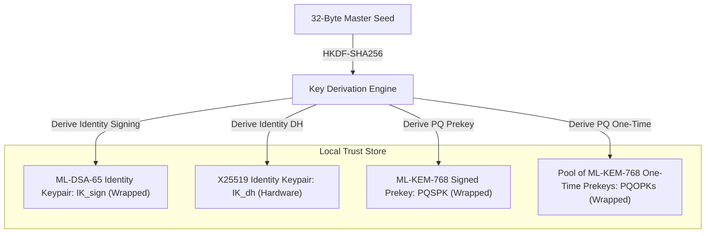
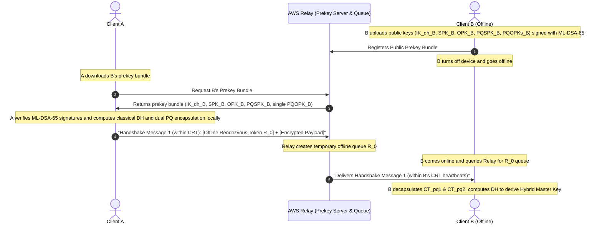
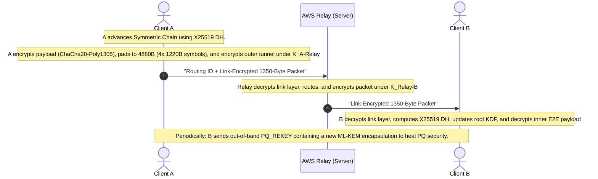
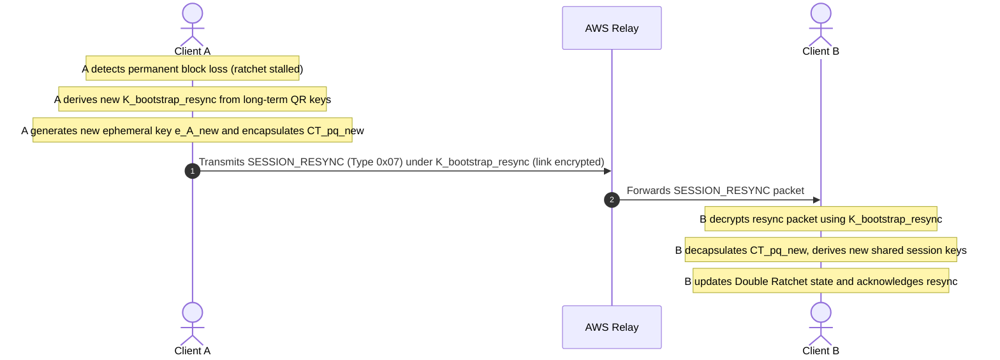

# Cryptographic Flow: Hybrid Post-Quantum X3DH Architecture

This document describes the complete cryptographic architecture of the E2E Messenger, serving as a detailed extraction of the cryptographic flows defined in the master roadmap. It covers local key generation, session initialization using a hybrid post-quantum X3DH handshake with ephemeral forward secrecy and KCI-binding, rolling message encryption via the Double Ratchet, and a detailed walkthrough of a message lifecycle.

---

## 1. Architectural Role Summary

* **Clients (Alice & Bob)**: Generate all keys locally, handle all asymmetric/symmetric cryptography, enforce 1350-byte fixed-size transport padding, and run the Constant-Rate Tunnel (CRT) timing loops. Private keys never leave the client devices.
* **AWS Relay**: Serves as a public prekey bundle directory, temporarily queues encrypted handshake/message payloads for offline clients, and implements metronomic transmission grids to defeat timing correlation attacks. It has zero visibility into E2E keys or plaintext payloads.

---

## 2. Phase 1: Key Generation (Client Local Setup)

Both clients independently generate their key material from a 32-byte master seed. Due to API limitations in the Samsung Knox Secure Element for PQ primitives, ML-DSA/ML-KEM keys are generated in RAM and securely wrapped by a hardware KEK at rest.

---

## 3. Phase 2: Session Initialization (Hybrid PQXDH Handshake)

This flow allows Client A to initiate an authenticated, post-quantum secure session even if Client B is offline.

---

## 4. Phase 3: Active Messaging & Asynchronous PQ Ratchet

Once the session is initialized, active messages utilize the classical X25519 Double Ratchet to comply with MTU limits, while PQ session healing occurs asynchronously:

---

## 5. Phase 4: Session Healing & Resync Handshake

If the client experiences prolonged extreme packet loss (loss > 98%), the receiver may fail to collect the minimum $K+\epsilon$ symbols needed to decode an FEC block. This permanently breaks the Double Ratchet key sequence. To recover, the clients perform a **Session Healing Handshake**:

---

## 6. Detailed Step-by-Step Message Lifecycle Walkthrough

### Step 1: Device Setup & Registration
Before B can receive any messages, B must initialize its keys and register with the server:
1. **Entropy to Keys**: Client B takes a high-entropy 32-byte seed (stored securely in **Samsung Knox Vault**) and runs it through HKDF-SHA256 to derive:
   - An **ML-DSA-65 identity signing keypair** ($IK_{sign}^B$).
   - A **classical X25519 identity DH keypair** ($IK_{dh}^B$).
   - A **post-quantum ML-KEM-768 keypair** ($PQSPK_B$).
   - A pool of **post-quantum ML-KEM-768 One-Time Prekeys** ($PQOPKs_B$).
2. **Prekey Signing**: Client B signs its public $IK_{dh}^B$, $PQSPK_B$, and each individual $PQOPK_B$ public key using its private $IK_{sign}^B$ key using **ML-DSA-65**.
3. **Registration**: B uploads these public keys and signatures to the AWS Relay's public directory. B then goes offline (device off).

### Step 2: Session Initiation
Client A decides to send a message to Client B. A has already verified B's ML-DSA-65 public key out-of-band:
1. **Fetch Bundle**: Client A queries the AWS Relay for B's prekey bundle ($IK_{dh}^B, SPK_B, PQSPK_B, PQOPK_B$).
2. **Verify & Fallback Check**: A uses B's public ML-DSA-65 key to verify the signatures on B's prekeys. 
   - **Normal Case**: If a post-quantum one-time prekey ($PQOPK_B$) is available in the bundle, A fetches it.
   - **PQOPK Depleted Case**: If the relay indicates B's pool of $PQOPKs$ is exhausted, Alice proceeds to derive the session under a **Degraded PQ Forward Secrecy** state, marking a session flag to execute an immediate E2E interactive re-keying as soon as Bob is online.
3. **Local Ephemeral Generation**: A generates a classical ephemeral X25519 keypair ($e_A$).
4. **Hybrid Cryptographic Computations**:
   - **Classical DH Steps**: A computes:
     * $DH_1 = \text{X25519}(IK_{dh}^A, SPK_B)$
     * $DH_2 = \text{X25519}(e_A, IK_{dh}^B)$
     * $DH_3 = \text{X25519}(e_A, SPK_B)$
     * $DH_4 = \text{X25519}(e_A, OPK_B)$ (if available).
   - **Post-Quantum Encapsulation Step**: 
     - A runs the ML-KEM encapsulation algorithm using B's public $PQSPK_B$ key, producing static shared secret $SS_{pq1}$ and encapsulation ciphertext $CT_{pq1}$.
     - **Normal Case**: A runs the encapsulation using Bob's one-time $PQOPK_B$ key, producing ephemeral shared secret $SS_{pq2}$ and encapsulation ciphertext $CT_{pq2}$.
     - **Depleted Case**: $SS_{pq2}$ and $CT_{pq2}$ are replaced with a static 32-byte zero buffer (or omitted) in the derivation.
5. **Key Derivation (The Master Key)**: A feeds all derived secrets and the public parameter identity transcripts into HKDF to cryptographically bind the session:
   $$\text{Master Key} = \text{HKDF-SHA256}(DH_1 \dots DH_4 \mathbin{\Vert} SS_{pq1} \mathbin{\Vert} SS_{pq2} \mathbin{\Vert} IK_{dh}^A \mathbin{\Vert} IK_{dh}^B \mathbin{\Vert} e_A \mathbin{\Vert} CT_{pq1} \mathbin{\Vert} CT_{pq2})$$
   A uses this Master Key to initialize the **Double Ratchet** state machine.
6. **Payload Encryption & Padding Math**: A advances the Double Ratchet's sending chain to produce a message encryption key ($MK_{1}$), and encrypts the message payload using standard **ChaCha20-Poly1305** (using a sequence-derived 96-bit nonce). A then pads the ciphertext with secure random bytes to exactly **4880 bytes** (yielding four perfectly divisible 1220-byte source symbols for RaptorQ).
7. **Obfuscation & Transmission**:
   - A builds the handshake packet payload: $[e_A \mathbin{\Vert} CT_{pq1} \mathbin{\Vert} CT_{pq2} \mathbin{\Vert} \text{Encrypted Payload}]$.
   - A encrypts the packet using the hop-by-hop transport key $K_{A-Relay}$ with **XChaCha20-Poly1305** and a random 192-bit nonce.
   - A sets the outer routing token to the pre-computed **Offline Rendezvous Token** ($R_0$).
   - A transmits this packet to the AWS Relay during A's regular 100ms CRT heartbeat tick.

### Step 3: Offline Storage & Delivery
1. **Queuing**: The AWS Relay receives the packet, decrypts the outer transport layer using $K_{A-Relay}$, and extracts the destination routing token ($R_0$). Finding no active socket matched to $R_0$, the relay places the E2E encrypted payload in a temporary offline RAM queue keyed to $R_0$.
2. **Draining**: When B turns their phone back on and establishes a Constant-Rate Tunnel via Tor, B anonymously queries the relay for a look-ahead window of queues ($R_0 \dots R_{10}$). The relay encrypts the queued blocks under B's transport key $K_{Relay-B}$, and transmits them inside B's heartbeat stream.

### Step 4: Decryption & Response
Client B receives the packet:
1. **Transport Decryption**: B decrypts the outer transport layer using its transport key $K_{Relay-B}$, extracting the E2E payload.
2. **Replay Attack Prevention**: Bob checks the packet's ephemeral key ($e_A$) against a local database of previously processed handshakes. If it matches, the packet is a malicious replay from the relay and is instantly dropped. Upon the first successful message retrieval, Bob permanently blacklists the $R_0$ token locally.
3. **Post-Quantum Decapsulation & Transaction Boundary**: B extracts $CT_{pq1}$ and $CT_{pq2}$, decapsulates them using its private $PQSPK_B$ key and private $PQOPK_B$ key (stored securely), and recovers the secrets $SS_{pq1}$ and $SS_{pq2}$. 
   - **Critical Atomicity (Keystore WAL)**: Because the OS File System and the Hardware Keystore are independent, a naive two-step deletion risks a Two-Phase Commit failure if the device crashes between operations. The client implements a **Write-Ahead Log (WAL)**: Bob writes an encrypted "Intent to Delete $PQOPK_B$" to the SQLite database. He then deletes the key from Knox Vault, and finally clears the intent. This mathematically guarantees the session state is not permanently locked if the OS panics.
4. **Classical DH**: B computes the classical $DH_1 \dots DH_4$ operations using its private keys and A's public keys.
5. **Master Key Derivation**: B computes:
   $$\text{Master Key} = \text{HKDF-SHA256}(DH_1 \dots DH_4 \mathbin{\Vert} SS_{pq1} \mathbin{\Vert} SS_{pq2} \mathbin{\Vert} IK_{dh}^A \mathbin{\Vert} IK_{dh}^B \mathbin{\Vert} e_A \mathbin{\Vert} CT_{pq1} \mathbin{\Vert} CT_{pq2})$$
6. **Payload Decryption & Interactive Upgrades**: 
   - B initializes its Double Ratchet receiving chain with the derived Master Key, derives the message key ($MK_{1}$), and decrypts the standard **ChaCha20-Poly1305** payload to read the message.
   - **Post-Handshake Rekeying**: If Bob detects the session is marked with the **Degraded PQ Forward Secrecy** flag, Bob's client immediately generates a fresh ephemeral ML-KEM-768 keypair, runs encapsulation against Alice's public parameters in a reverse-challenge packet, and updates the session root key to upgrade the session to full PQ forward secrecy.
