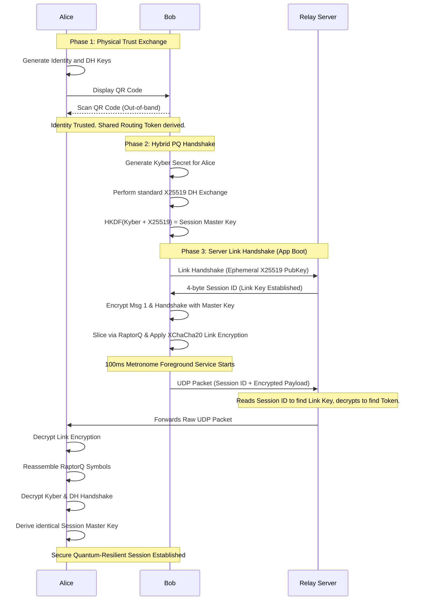
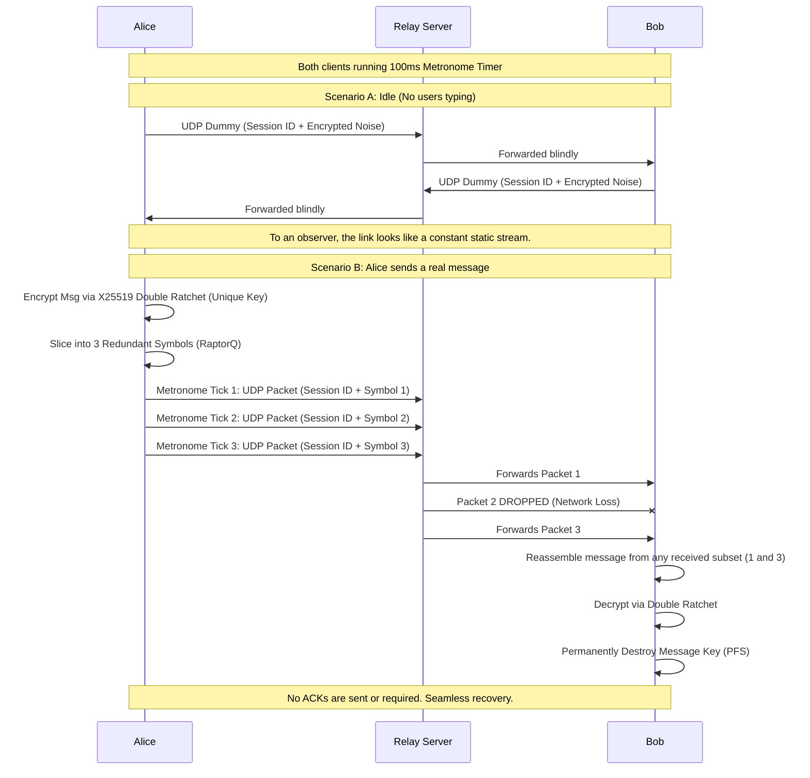
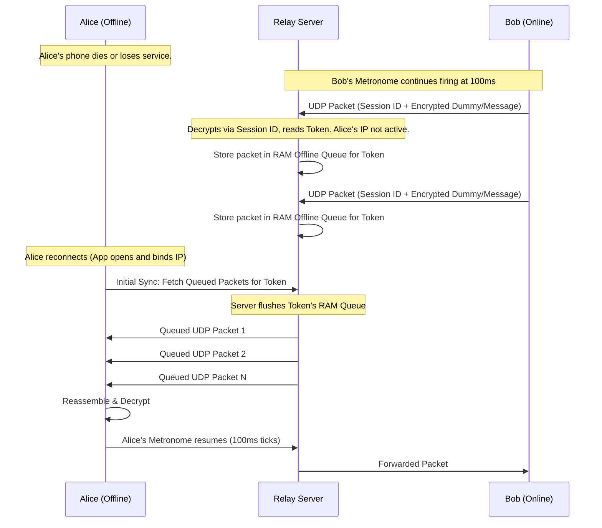

# E2E-Messenger: Protocol Flow Diagrams

This document illustrates the core operational flows of the E2E-Messenger architecture. It covers the initial physical and cryptographic handshake, the ongoing metronomic communication, and the offline queuing mechanism.

## 1. Initial Handshake & Session Bootstrapping

This diagram shows how trust is established out-of-band via QR code, followed by the first message that utilizes the Hybrid Post-Quantum Key Exchange to establish a Master Key.

## 2. Messaging Back & Forth (The Metronomic Tunnel)

This diagram illustrates the constant-rate tunnel. Packets are fired continuously every 100ms, effectively masking when real messages are being sent. It also shows how RaptorQ handles packet loss without requiring a traditional network "ACK".

## 3. Offline Queuing & Retrieval

This diagram shows how the stateless relay handles disconnected users. Because the server only maps Routing Tokens to IPs or RAM queues, it doesn't need to manage user accounts to buffer messages.

You have identified the exact edge-cases that make blind routing tricky! To make this work securely without the server confusing the IPs, and without Alice getting Bob and Paul's messages mixed up, the system relies on Unidirectional Inbox Tokens and Cryptographic Demultiplexing.

Here is exactly how both of those problems are solved:

1. How does the server get the routing IDs without confusing Alice and Bob?
While the QR code scan establishes a "Shared Secret" between Alice and Bob, they do not actually use a single shared token to route traffic (otherwise, as you noted, the server wouldn't know which IP is the sender and which is the receiver).

Instead, they take that Shared Secret and feed it into a Key Derivation Function (KDF) to deterministically generate Two Unidirectional Routing Tokens:

Token A (Alice's Inbox): Used only for messages traveling from Bob to Alice.
Token B (Bob's Inbox): Used only for messages traveling from Alice to Bob.
How the Server routes:

Registration: Every 100ms, Alice's metronome sends a tiny "Keep-Alive" control packet to the Server. She puts Token A on the front of this packet. The Server reads it and updates its HashMap: Token A -> Alice's IP.
(Bob does the exact same thing with Token B, so the server maps Token B -> Bob's IP).
Sending a Message: When Bob wants to send a message to Alice, his app prepends Token A to the message packets.
The Server receives Bob's message, looks up Token A in the HashMap, and instantly forwards it to Alice's IP.
Because the tokens are strictly one-way (unidirectional), the Server never gets confused about whose IP belongs to which token.

2. How does Alice know a message is from Bob and not Paul?
This is solved by the fact that the Routing Tokens are strictly pairwise (unique to every specific conversation).

When Alice scans Bob's QR code, they generate Token A (Bob → Alice).
When Alice scans Paul's QR code, they generate a completely different shared secret, resulting in Token C (Paul → Alice).
The Demultiplexing Process (How Alice's App sorts it out): When a raw UDP packet arrives at Alice's phone, her app looks at the 16-byte Routing Token on the front of the packet.

If the packet has Token A, her app knows immediately: "This is from Bob. I need to use Bob's XChaCha20 link key to decrypt the outer layer, and Bob's Double Ratchet state to decrypt the message."
If the packet has Token C, her app knows: "This is from Paul. I must use Paul's keys."
If the packet has an unknown Token that Alice's app doesn't recognize, it is instantly dropped as cryptographic noise.
This concept is called Cryptographic Demultiplexing. Because Alice manages a unique "Inbox Token" for every single person she talks to, her app always knows exactly who sent the packet and which cryptographic keys are required to unlock it, all without the Server ever knowing who "Token A" or "Token C" belong to!