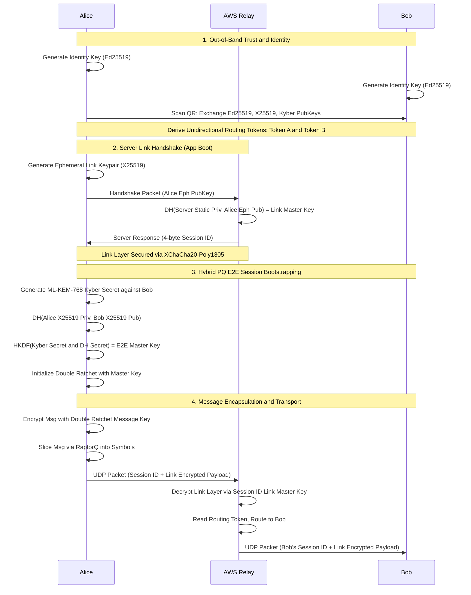
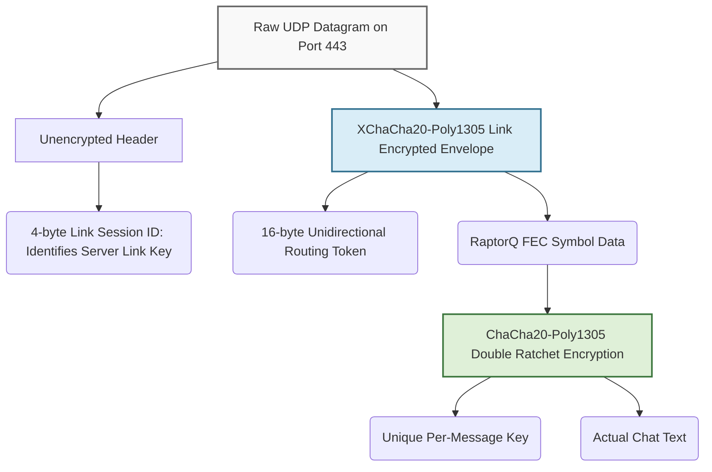

# Doable Cryptographic Flow: MVP Architecture

This document describes the simplified, realistic cryptographic architecture of the E2E Messenger MVP, as defined in the `doable-roadmap.md`. It explains the step-by-step flow from local key generation to metronomic transmission, highlighting the specific compromises and weaknesses inherent in a 12-week university scope.

---

## 1. Architectural Role Summary

*   **Clients (Alice & Bob)**: Generate all keys locally in memory (no Samsung Knox hardware APIs). Trust is established strictly in person via QR codes (no cloud prekey servers). The clients handle all asymmetric/symmetric cryptography, RaptorQ Forward Error Correction (FEC), and the Constant-Rate Tunnel (CRT) UDP metronome.
*   **AWS Relay**: A "dumb" RAM-only router. It has zero knowledge of User IDs or E2E keys. The relay uses a "WireGuard-Lite" X25519 Link Handshake to establish ephemeral link keys with clients. It reads an unencrypted 4-byte Session ID to identify the link key, decrypts the outer shell, reads the routing token, and routes or queues the raw UDP packet.

---

## 2. Phase 1: Local Setup & In-Person Trust (QR Exchange)

Unlike production apps that use complex cloud key directories, this MVP establishes absolute trust out-of-band.

1.  **Local Key Generation**: The Rust core on Alice's device generates three long-term keypairs:
    *   **Ed25519**: For identity signing.
    *   **X25519**: For classical Diffie-Hellman key exchange.
    *   **ML-KEM-768 (Kyber)**: For post-quantum key encapsulation.
2.  **QR Code Display**: Alice's Kotlin UI displays a QR code containing her three public keys.
3.  **Scanning & Trust**: Bob scans Alice's QR code (and Alice scans Bob's). 
4.  **Routing Token Derivation**: Both devices hash the combined public keys (e.g., `SHA256(AlicePub || BobPub)`) to generate a unique 16-byte shared **Routing Token**. This token will be used to tell the AWS Relay where to route the packets.

---

## 3. Phase 2: Session Initialization (Hybrid PQ Bootstrapping)

The very first message Alice sends to Bob must bootstrap the secure session.

1.  **Post-Quantum Encapsulation**: Alice uses the `pqcrypto-kyber` crate to encapsulate a random secret against Bob's public ML-KEM key (which she got from the QR code). This produces a shared secret ($SS_{pq}$) and an encapsulation ciphertext ($CT_{pq}$).
2.  **Classical DH**: Alice computes the standard X25519 Diffie-Hellman shared secret ($SS_{dh}$) using her private X25519 key and Bob's public X25519 key.
3.  **Hybrid Key Derivation (HKDF)**: Alice merges the classical and post-quantum secrets to create the unbreakable Master Key:
    `Master Key = HKDF-SHA256( SS_{dh} || SS_{pq} )`
4.  **Ratchet Initialization**: Alice uses this Master Key to initialize the root chain of her standard **X25519 Double Ratchet** state machine.

---

## 4. Phase 3: Active Messaging (E2E & RaptorQ)

Once the session is bootstrapped, ongoing messaging relies purely on the classical Double Ratchet to save bandwidth.

1.  **Message Encryption**: Alice types a message. The Double Ratchet advances and spits out a unique Message Key. The payload is encrypted using standard **ChaCha20-Poly1305**.
2.  **RaptorQ FEC Slicing**: To survive 95% packet loss without ACKs, the encrypted ciphertext is fed into the Rust `raptorq` crate. It is padded to a fixed size and sliced into redundant mathematical repair symbols.

---

## 5. Phase 4: Network Transport & Obfuscation

To evade traffic analysis and DPI, the symbols must be obfuscated.

1.  **Link Encryption**: To hide the RaptorQ headers and the Routing Token from the ISP, Alice wraps the entire packet in an outer layer of **XChaCha20-Poly1305**.
    *   *Server Key-Pinning*: She encrypts this outer shell using an ephemeral Link Master Key established via an X25519 handshake with the server's hardcoded public key when the app boots. She prepends an unencrypted 4-byte Session ID to the outside of the packet so the server knows which key to use.
2.  **The Metronome**: A Rust `tokio` thread running in an Android Foreground Service transmits exactly one UDP packet every 100ms. 
    *   If there are RaptorQ symbols in the queue, it sends one.
    *   If the user isn't typing, it generates and sends a random Dummy Packet of the exact same size to ensure the traffic rate never fluctuates.

---

## 6. Detailed Cryptographic Diagrams & Walkthrough

### A. Full Cryptographic Key Exchange Flow

This diagram illustrates how all the disparate cryptographic primitives (Ed25519, X25519, ML-KEM) interact to establish the end-to-end trust, the stateless server link, and the session master key.

### B. Nested Packet Encapsulation Structure

This block diagram demonstrates exactly what a single UDP datagram looks like on the wire, showing how the routing IDs, Session IDs, and E2E layers are nested to prevent metadata leakage.

### C. Step-by-Step Packet Walkthrough

1.  **Alice (Client)** encrypts a message via Double Ratchet.
2.  **Alice** slices it into 5 RaptorQ symbols.
3.  **Alice's Metronome** wakes up (Tick 1):
    *   Takes Symbol 1, prepends the 16-byte Routing Token.
    *   Encrypts the block with the Link Master Key (XChaCha20).
    *   Prepends the unencrypted 4-byte Link Session ID to the outside.
    *   Fires it over raw UDP to AWS Relay port 443.
4.  **AWS Relay** receives the UDP packet.
    *   Reads the 4-byte Session ID and looks up Alice's Link Master Key in RAM.
    *   Decrypts the outer layer using the Link Master Key.
    *   Reads the 16-byte Routing Token.
    *   Looks up the token in its RAM `HashMap`.
    *   Routes the inner payload to Bob's IP (or queues it if Bob hasn't pinged in 5 seconds).
5.  **Bob (Client)** receives the packet.
    *   Passes it to the RaptorQ decoder.
    *   Once enough symbols arrive (e.g., 3 out of 5), RaptorQ reconstructs the E2E ciphertext.
    *   Bob's Double Ratchet derives the matching key and decrypts the message to the UI.

---

## 7. Known Weaknesses & Architectural Compromises (The "MVP Issues")

Because this is a 12-week university scope, several production-grade security features were cut. These must be acknowledged as limitations:

### A. The X25519 Link Handshake (Replaces PSK)
*   **The Upgrade**: Originally, a universal Pre-Shared Key (PSK) was planned for link encryption, which was a massive security vulnerability. This has been replaced by a "WireGuard-Lite" handshake. The AWS Relay's static X25519 public key is hardcoded into the app. When the app boots, it generates an ephemeral keypair and performs a DH exchange with the server's public key to establish a unique Link Master Key, receiving a 4-byte Session ID in return. 
*   **The Result**: If someone extracts the hardcoded server public key from the APK, it is useless to them. They cannot decrypt other users' link traffic because they lack the server's private key. The 4-byte Session ID securely identifies incoming packets despite mobile IP roaming.

### B. Double Ratchet Memory Bounds (Resolved)
*   **The Issue**: The standard Double Ratchet handles dropped messages by saving derived keys for "skipped" messages in a dictionary indefinitely. Under 95% UDP loss, the number of permanently lost messages is massive, which would cause an Out-Of-Memory (OOM) crash.
*   **The MVP Fix**: The MVP hardens the ratchet by implementing a strict `MAX_SKIP = 500` limit and a 5-minute Time-To-Live (TTL) on all skipped keys. Because UDP is connectionless and the app uses a strict 100ms metronome, if a RaptorQ symbol hasn't arrived within 5 minutes, it is physically impossible for it to arrive later (it was dropped by a router long ago). Thus, pruning it after 5 minutes is mathematically safe and permanently fixes the memory leak.

### C. Asynchronous PQ Session Healing (Resolved via Session Reset)
*   **The Issue**: The MVP only uses Post-Quantum protection on the *initial* session handshake. If a quantum computer breaks the classical X25519 Double Ratchet, long-lived sessions could eventually become vulnerable.
*   **The MVP Fix**: Modifying the internal ratchet for mid-stream Kyber mix-ins is too complex for a 12-week PoC. Instead, the MVP uses a "Blunt Force" Cryptographic Session Reset. Triggered either manually via a UI button or automatically every 100 messages, Alice encapsulates a new Kyber secret against Bob's long-term public key and sends a control packet. Both clients then completely wipe their current Double Ratchet state in RAM and reboot a brand new session, achieving PQ Forward Secrecy without complex internal ratchet surgery.

### D. The Multicast Bind Spoofing (Stretch Goal)
*   **The Issue**: If Ephemeral Multicast is implemented, the server routes messages based on unauthenticated `MULTICAST_BIND` control packets.
*   **The Vulnerability**: An attacker who guesses a group's Routing Token can inject a fake bind command to wiretap the metadata stream of the group chat. Without complex Zero-Knowledge Proofs (which are out of scope), the blind server has no way to verify if a user actually belongs to the group.
