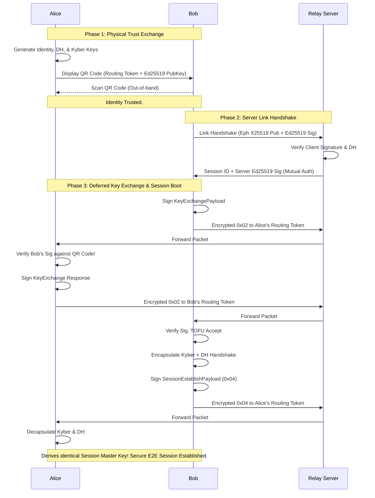
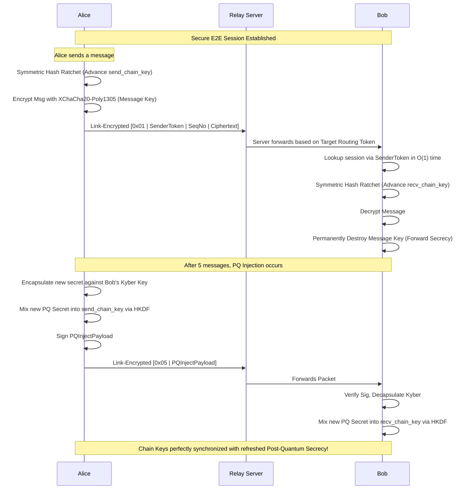
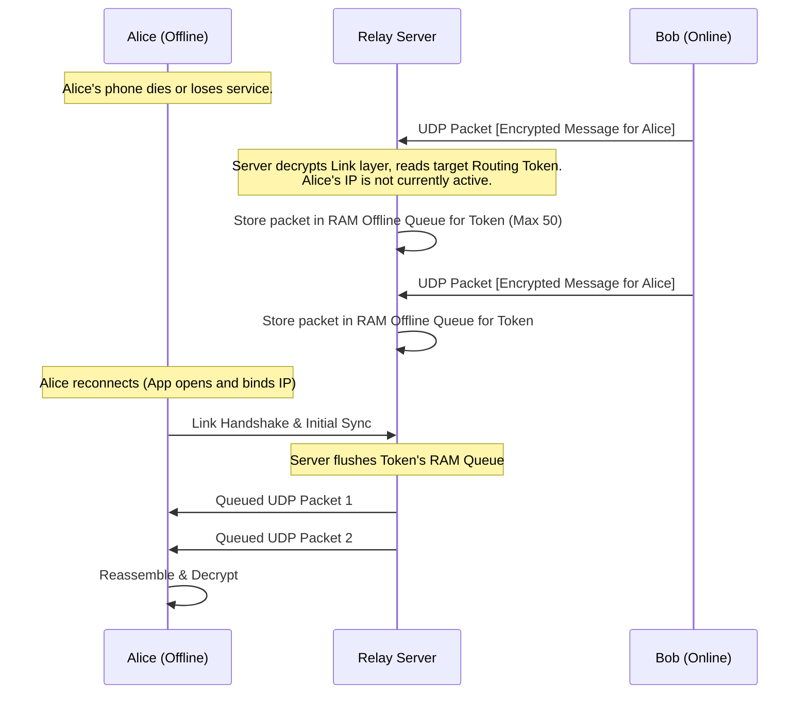
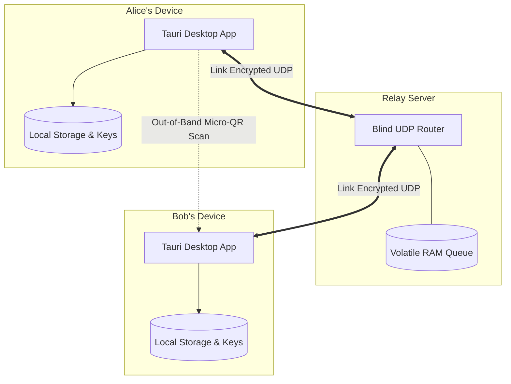
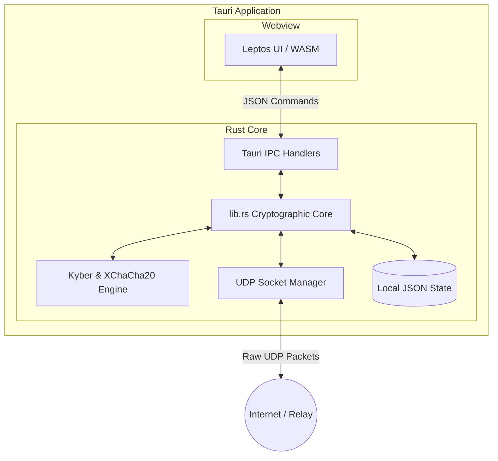

# E2E-Messenger: Protocol Flow Diagrams

This document illustrates the core operational flows of the E2E-Messenger architecture as **currently implemented in the codebase**. It covers the initial physical and cryptographic handshake, active messaging using the Symmetric Hash Ratchet and PQ Injections, and the offline queuing mechanism.

## 1. Initial Handshake & Session Bootstrapping

This diagram shows how trust is established out-of-band via a Micro-QR code, followed by the Deferred Key Exchange which utilizes a Hybrid Post-Quantum Key Exchange to establish a Master Key.

## 2. Active Messaging & PQ Ratcheting

This diagram illustrates the active messaging flow. Instead of a complex double ratchet, the current MVP uses a highly concurrent Bidirectional Symmetric Hash Ratchet, utilizing `SenderToken` for $O(1)$ lookups, and injecting fresh Post-Quantum entropy every 5 messages.

## 3. Offline Queuing & Retrieval

This diagram shows how the stateless relay handles disconnected users. Because the server maps Routing Tokens directly to active IPs or RAM queues, it securely stores messages for offline peers without any persistent storage or user accounts.

## 4. High-Level Topology (The 10,000-Foot View)

This diagram shows the broad network layout. It highlights that the server is completely untrusted and has no persistent database, while all sensitive cryptographic keys and session states remain strictly isolated on the local devices.

## 5. Component & Data Flow (The Tech Stack)

This diagram illustrates the internal architecture of the desktop client. It shows how the Leptos WebAssembly frontend communicates with the Rust core via Tauri's IPC bridge, and how the cryptographic engine manages the UDP network state.

