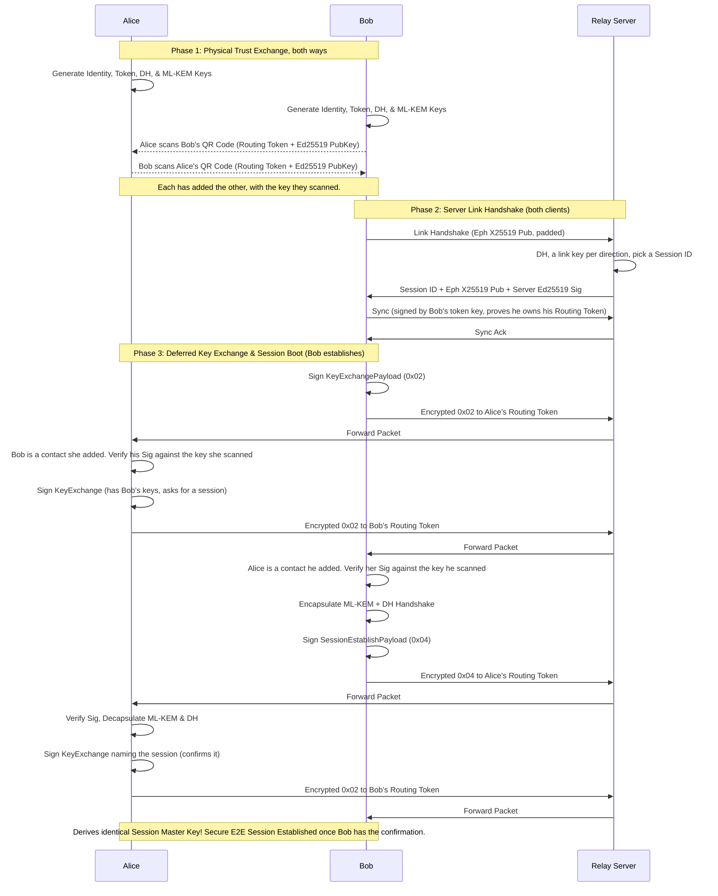
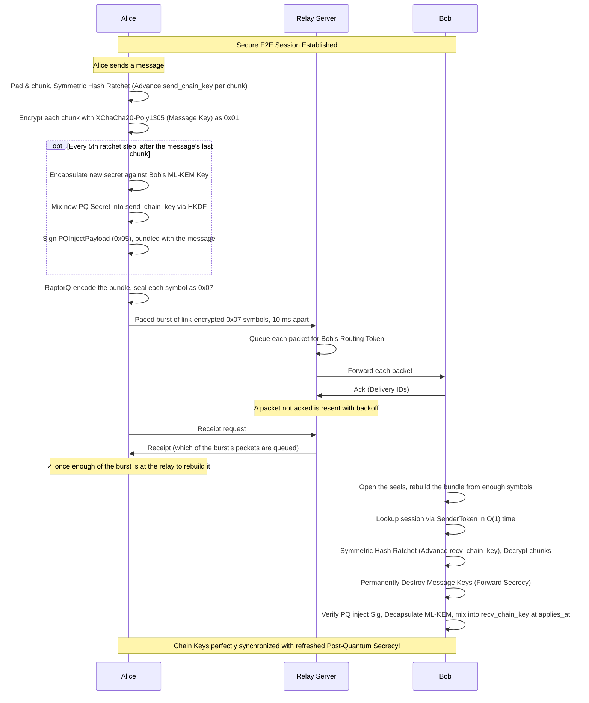
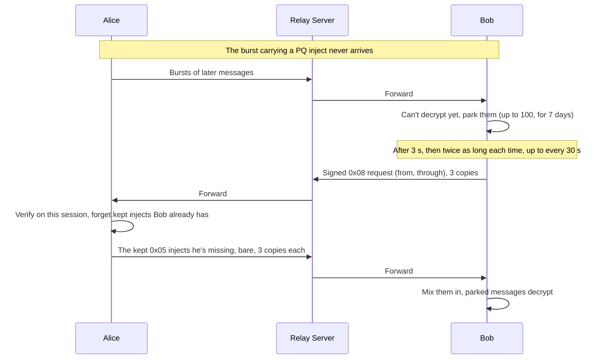
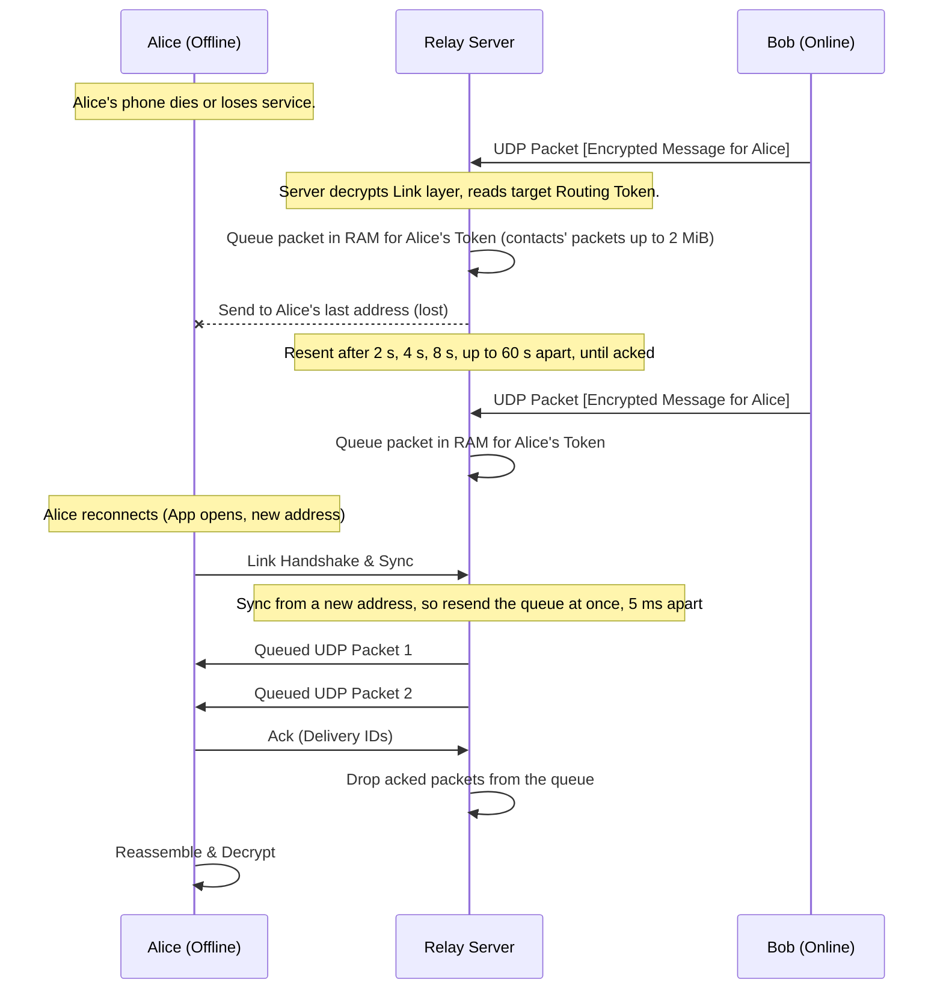
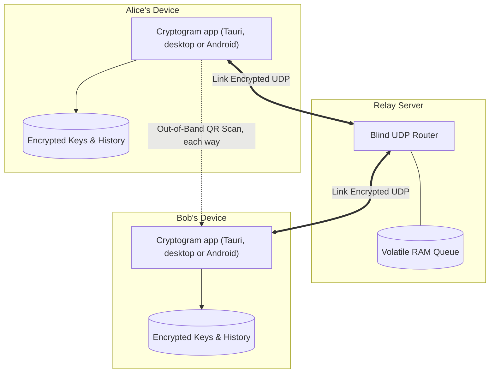
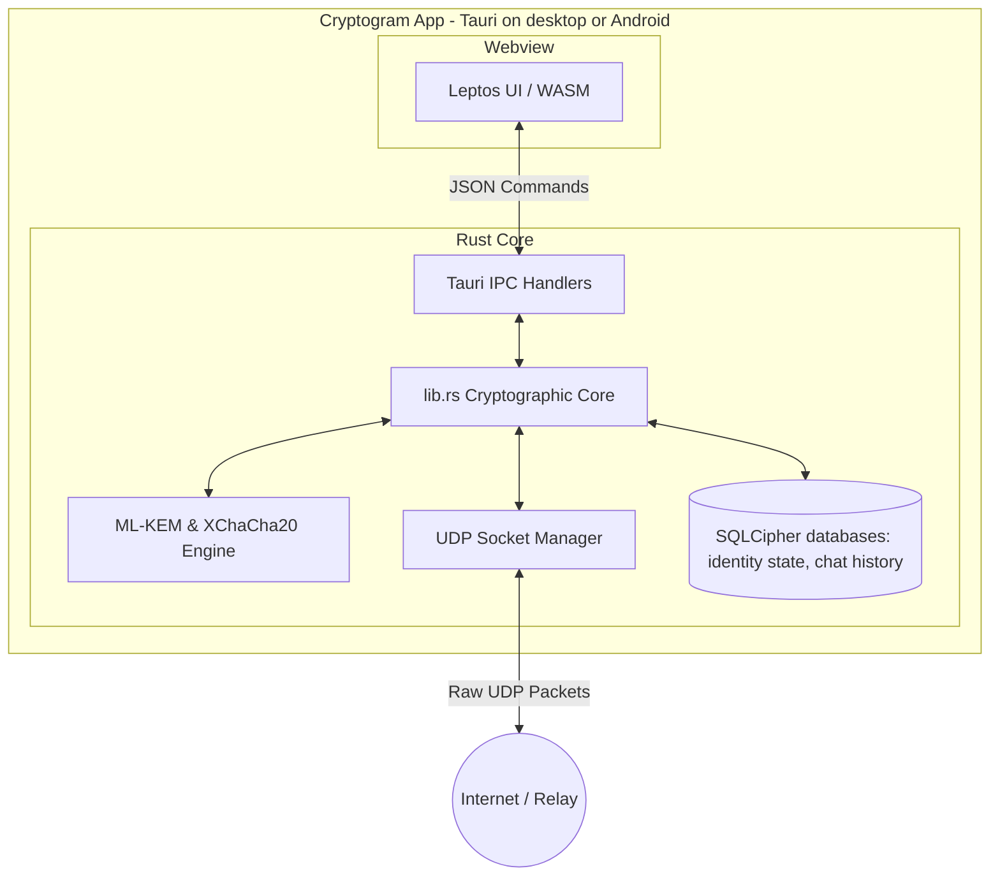

# E2E-Messenger: Protocol Flow Diagrams

This document illustrates the core operational flows of the E2E-Messenger architecture as **currently implemented in the codebase**. It covers the initial physical and cryptographic handshake, active messaging using the Symmetric Hash Ratchet and PQ Injections, and the offline queuing mechanism.

## 1. Initial Handshake & Session Bootstrapping

Trust is established out-of-band: both people scan each other's QR code. The Deferred Key Exchange then swaps the large keys over the relay, and a Hybrid Post-Quantum Key Exchange establishes a Master Key. Each side only takes in a KeyExchange from someone it added itself, checked against the key it scanned; one from anyone else is dropped and listed as a connection request. The contact with the lower routing token is the *establisher* and sends the SessionEstablish. The *responder* confirms it with a KeyExchange naming the session, and only then does the establisher use it. Below, Bob's token is the lower.

## 2. Active Messaging & PQ Ratcheting

This diagram illustrates the active messaging flow. Instead of a double ratchet, the current MVP uses a Bidirectional Symmetric Hash Ratchet, utilizing `SenderToken` for $O(1)$ lookups, and injecting fresh Post-Quantum entropy every 5 ratchet steps. A message travels as a paced burst of sealed `0x07` RaptorQ symbols, sized to survive 70% loss. When a PQ inject is due, it rides inside the same burst as the message, not as a packet of its own, so the two arrive together or not at all. The relay keeps each packet until the recipient acks it. The sender's ✓ comes from the relay's receipts, not from the recipient.

### Recovering a Lost PQ Inject

If a burst carrying an inject is lost altogether, nothing after it decrypts. The receiver parks those messages and asks for the inject again with a signed `0x08` request; the sender keeps its latest 20 injects per session for this. A request signed on an older session (sent before a repair) is ignored. An inject older than the latest 20 can't be sent again: the session needs **Repair session**, which sets up a new one and keeps the contact and the chat history.

## 3. Offline Queuing & Retrieval

This diagram shows how the RAM-only relay handles disconnected users. Because the server maps Routing Tokens directly to the address each one has proven it's at, with a RAM queue behind it, it holds messages for offline peers without any persistent storage or user accounts. Every forwarded packet waits in the queue until the recipient acks it: up to 2 MiB per recipient for its contacts' packets (new ones refused once full) and 64 KiB for everyone else's, for up to 7 days. Unacked packets are resent with backoff, and at once (paced 5 ms apart) when the recipient syncs from a new address or link, or after more than 30 seconds of silence.

## 4. High-Level Topology (The 10,000-Foot View)

This diagram shows the broad network layout. It highlights that the server is completely untrusted and has no persistent database, while all sensitive cryptographic keys and session states remain strictly isolated on the local devices. Each device runs the Cryptogram app: a Leptos UI in a Tauri shell, on desktop or Android.

## 5. Component & Data Flow (The Tech Stack)

This diagram illustrates the internal architecture of the Cryptogram app. It shows how the Leptos WebAssembly frontend communicates with the Rust core via Tauri's IPC bridge, and how the cryptographic engine manages the UDP network state. State is kept in two SQLCipher databases, one for the identity and its sessions and one for the chat history, both keyed from the passcode. It's the same on Android, where the Tauri shell runs the same Rust backend behind the same webview UI.

