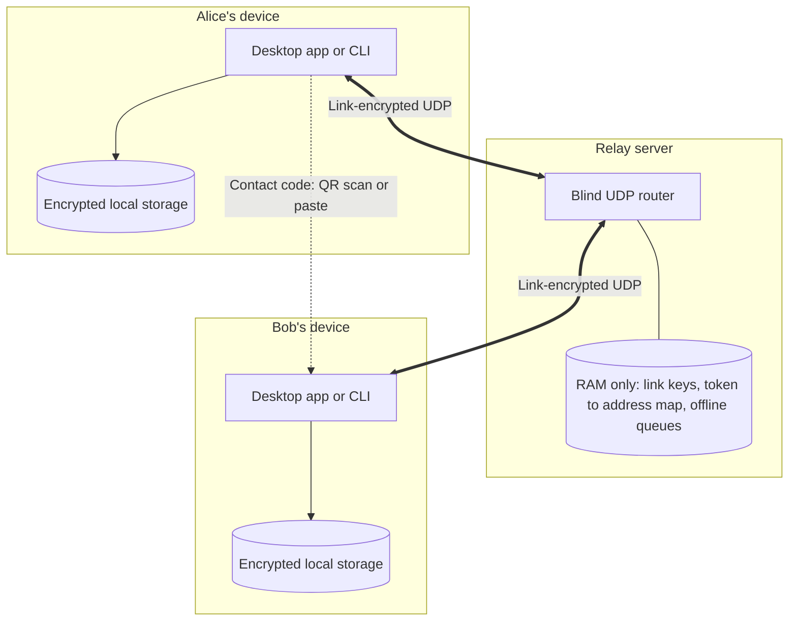
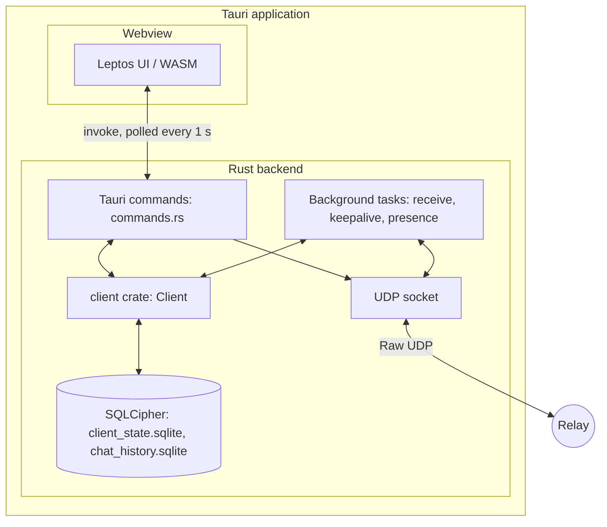
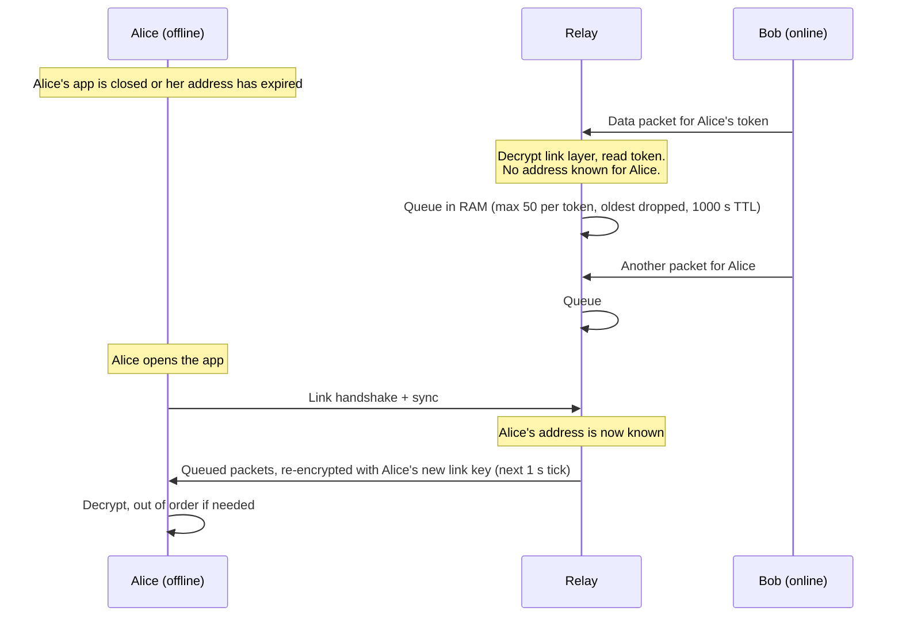

# Architecture

How E2E-Messenger is built as of the current `main` branch: the components, how they talk to each other, what goes over the wire, and where data is stored. The cryptography is covered in [cryptography.md](cryptography.md). Planned work that isn't built yet is in [roadmap.md](roadmap.md).

---

## 1. Design goals and current state

The project's aim is a messenger for hostile networks. Those networks have heavy packet loss, traffic analysis, and an untrusted server in the middle. The architecture follows from that:

- **No accounts, no central identity.** A user is a random 16-byte *routing token* plus a set of keypairs, generated locally. Contacts are added by exchanging a short contact code in person (QR code or copy-paste).
- **A blind relay.** The server only routes opaque, encrypted packets between routing tokens. It never holds end-to-end keys and keeps everything in RAM.
- **Raw UDP.** There is no TCP, QUIC or WebSocket. Every packet is a single UDP datagram, so a lost packet costs only itself and no connection has to be re-established.
- **Hybrid post-quantum encryption.** Sessions are set up with X25519 + Kyber-768, and new Kyber secrets are mixed in as the conversation goes on.

What's **not** built yet: forward error correction (RaptorQ), which is what makes heavy loss survivable, and constant-rate cover traffic. Today each message is sent once as one datagram, with no retry and no acknowledgement. See [§8](#8-not-yet-implemented).

---

## 2. Components

| Component | Path | What it is |
|---|---|---|
| Relay server | [`code/server`](../code/server) | Tokio UDP server. It does the link handshake with each client, routes packets by routing token, and queues packets for offline recipients in RAM. |
| Client core | [`code/client`](../code/client) (`lib.rs`) | The whole protocol and all cryptography: identities, the link handshake, key exchange, the ratchet, PQ injection, presence, and encrypted local storage. Used as a library by both front ends. |
| CLI | [`code/client`](../code/client) (`main.rs`) | A terminal REPL that drives the client core. Used for quick testing and in Docker. |
| Desktop UI | [`code/frontend/src`](../code/frontend/src) | Leptos UI, compiled to WebAssembly by Trunk. It contains no crypto or networking. |
| Desktop shell | [`code/frontend/src-tauri`](../code/frontend/src-tauri) | Tauri 2 app that hosts the UI. It owns the UDP socket and a live `Client`, and exposes them to the UI as `#[tauri::command]`s. |

The client core is used unchanged by both front ends. Each front end only supplies a socket, a receive loop and its own UI.

---

## 3. Topology



Clients never talk to each other directly. Every packet goes to the relay, which re-encrypts it for the recipient's link and forwards it.

### Inside the desktop app



The UI calls commands through Tauri's `window.__TAURI__.core.invoke` (see [`api.rs`](../code/frontend/src/api.rs)). Nothing is pushed from the backend. The UI polls `list_contacts` and `poll_inbox` once a second. The full command list is in the [frontend README](../code/frontend/README.md#tauri-commands).

---

## 4. Wire format

All packets are UDP datagrams. The default port is 4430 for local development and 443 when the relay runs in Docker or on EC2.

### Link layer (client ↔ relay)

| Packet | Layout | Size |
|---|---|---|
| Handshake init (client → relay) | `0x00 · session_id[4] · client_eph_x25519[32] · client_ed25519[32] · sig[64]` | 133 B |
| Handshake response (relay → client) | `0x02 · session_id[4] · relay_eph_x25519[32] · sig[64]` | 101 B |
| Data (both directions) | `0x01 · session_id[4] · nonce[24] · XChaCha20-Poly1305(link_key, token[16] · inner)` | 61 B + inner (includes the 16-byte tag) |

- `session_id` is 4 random bytes chosen by the client. It's sent in the clear so the relay knows which link key to use.
- In client → relay data packets, `token` is the **destination** routing token. If the client sends its **own** token with an empty `inner`, that's a *sync* packet: "this token is at my current address".
- In relay → client data packets, `token` is 16 zero bytes. The client strips it before parsing.

### Inner payloads (client ↔ client, carried inside the link layer)

The first byte of `inner` is the payload type.

| Type | Name | Body (after the type byte) | Body size | Protection |
|---|---|---|---|---|
| `0x01` | Message | `sender_token[16] · seq_no[8, BE] · nonce[24] · ciphertext` | 48 B + text + 16 B tag | E2E XChaCha20-Poly1305 with a ratchet message key |
| `0x02` | KeyExchange | header · `ed25519[32] · x25519[32] · kyber_pub[1184] · name[32]` · sig | 1384 B | Ed25519 signature |
| `0x04` | SessionEstablish | header · `kyber_ct[1088] · eph_x25519[32]` · sig | 1224 B | Ed25519 signature |
| `0x05` | PQInject | header · `kyber_ct[1088]` · sig | 1192 B | Ed25519 signature |
| `0x06` | Presence | header · sig | 104 B | Ed25519 signature |

`header` is `sender_token[16] · target_token[16] · unix_timestamp[8, BE]`. `sig` is a 64-byte Ed25519 signature over everything before it. `name` is the sender's display name in UTF-8, zero-padded to 32 bytes. Type `0x03` is unused. The sizes are pinned by a unit test in [`packets.rs`](../code/client/src/packets.rs).

```
UDP datagram
├── 0x01                         link packet type (data)
├── session_id [4]               clear; selects the relay's link key
├── nonce [24]
└── XChaCha20-Poly1305 (link key)            relay can decrypt this layer
    ├── routing token [16]                   destination (→ relay) or zeros (→ client)
    └── inner payload
        ├── type [1]                         0x01 / 0x02 / 0x04 / 0x05 / 0x06
        └── 0x01: sender_token · seq_no · nonce · XChaCha20-Poly1305 (message key)
                                             only the recipient can decrypt this layer
```

The largest packet in normal use is a KeyExchange, at 1446 bytes on the wire. That fits a typical 1500-byte MTU.

---

## 5. Message flows

### 5.1 Connecting to the relay

At startup the client does the link handshake with the relay. The relay signs its reply with its long-term Ed25519 key, and the client checks that against the relay pubkey the user pasted in. Both sides then derive a link key. The client follows up with a sync packet so the relay learns where to reach its routing token. The details are in [cryptography.md §3](cryptography.md#3-relay-link-handshake).

The relay's record of a token's address expires 1000 s after the last sync. Home and campus routers usually drop idle UDP mappings much sooner. The desktop app works around that by re-sending the sync packet every 15 s. The CLI doesn't, so a CLI peer behind NAT can stop receiving after a minute or so of silence.

### 5.2 Adding a contact and setting up a session

1. Bob shows his **contact code**: `cryptogram:v1:<routing token hex>:<ed25519 hex>`. He can present it as a QR code or copy it as text.
2. Alice scans or pastes it. That pins Bob's Ed25519 key in her `pending_contacts`, and she sends Bob a **KeyExchange**. A KeyExchange carries her full public keys, including the 1184-byte Kyber key, which is too big for a QR code. That's why the key exchange is *deferred*: it happens over the network after the scan.
3. Bob auto-accepts the request (trust on first use) and replies with his own KeyExchange.
4. Alice checks Bob's reply against the key she pinned from the contact code. She then runs the hybrid X25519 + Kyber handshake and sends **SessionEstablish**. Both sides now hold the same root key.

One side adding the other is enough to set up a session. The side that *received* the request trusted the embedded key on first use. If both people scan each other, each side verifies the other's key against what it pinned. The full sequence diagram and the checks are in [cryptography.md §4](cryptography.md#4-session-setup-deferred-key-exchange--pqxdh).

### 5.3 Sending a message

The sender advances its send chain, encrypts the text with the resulting message key, and sends a `0x01` packet addressed to the recipient's token. After every 5th message it also sends a `0x05` PQInject. The relay decrypts the link layer, reads the destination token, and queues the inner payload. Its outbound task runs **once a second**: for every token that has a known address, it re-encrypts the queued payloads under that recipient's link key and sends them. So delivery takes up to about 1 s even when both sides are online.

The receiver looks up the session by the sender token in the packet. It then decrypts, out of order if needed, using a skipped-key dictionary. The decrypted message goes into `Client::inbox` and, in the desktop app, into the local chat history.

### 5.4 Offline delivery



### 5.5 Presence and keepalive (desktop app only)

| Background task | Interval | What it sends |
|---|---|---|
| Keepalive | 15 s | A sync packet to the relay. This keeps the client's NAT mapping and the relay's address record alive. |
| Presence | 20 s | A signed `0x06` Presence packet to each established contact |

A contact is shown as **online** if any authenticated packet from them, a presence ping or a chat message, arrived in the last 45 s. Presence packets are signed but not encrypted and don't advance the ratchet. That online status is local to each peer and is never saved to disk.

---

## 6. Local storage

### Desktop app

Each identity has its own directory under the OS's per-app data folder. The bundle identifier is `nz.ac.waikato.compx374.e2e-messenger`.

| OS | Location |
|---|---|
| Linux | `~/.local/share/nz.ac.waikato.compx374.e2e-messenger/identities/` |
| Windows | `%LOCALAPPDATA%\nz.ac.waikato.compx374.e2e-messenger\identities\` |
| macOS | `~/Library/Application Support/nz.ac.waikato.compx374.e2e-messenger/identities/` |

```
identities/<username>/
├── passcode.hash         Argon2id parameters, salt and login verifier (no secrets)
├── client_state.sqlite   SQLCipher: identity keys and all session state
├── chat_history.sqlite   SQLCipher: every message sent and received
└── session.lock          OS file lock, held while this identity is logged in
```

Both databases are encrypted with a *vault key* derived from the passcode (see [cryptography.md §7](cryptography.md#7-local-secret-storage)). Older identities that still have a plaintext `client_state.json` are migrated to the encrypted store on their first login, and the plaintext file is then deleted.

### CLI

The CLI saves its state as **plaintext** JSON in `client_state.json` in the working directory, or wherever `E2E_STATE_FILE` points. It keeps no chat history.

### Relay

The relay keeps everything in RAM, with one exception: its long-term Ed25519 secret, which it writes to `server_identity.json` in its working directory as plaintext hex. In Docker that's the `/data` volume.

---

## 7. What the relay can see

The relay can't read message text, and it never holds end-to-end keys. It does decrypt the link layer, though, so it sees:

- the source IP and port, and the session ID of every packet;
- the destination routing token, and the inner payload type;
- the **sender's** routing token. It's in plain view inside every `0x01` message and every signed payload, so the relay can tell which tokens talk to each other;
- packet sizes and timing. No cover traffic is sent.

The relay also logs routing tokens and client addresses at `info` level. Keeping a deployed relay "blind" in practice means turning off or minimising those logs. The relay's tables and limits are in the [server README](../code/server/README.md).

---

## 8. Not yet implemented

| Feature | Original design | Current behaviour |
|---|---|---|
| Forward error correction | Split each encrypted message into RaptorQ symbols so any large-enough subset rebuilds it, with no ACKs. The target was 90–95% loss. | Each payload is one datagram, sent once. A lost datagram is a lost message. A lost PQInject breaks that direction of the session (see [cryptography.md §9](cryptography.md#9-open-issues)). |
| Constant-rate tunnel | Each client sends one packet every 100 ms, real or dummy, to hide when and how much people talk | Packets go out only when there's something to send. The relay has a code path for sending dummy packets, but it never picks any targets, so no dummy traffic is sent. |
| Large messages | Handled by FEC symbols | No fragmentation. The relay reads into a 2048-byte buffer, so a packet carrying more than about 1.9 KB of UTF-8 text doesn't fit and is dropped, with no error shown to the sender. |

Plans for these are in [roadmap.md](roadmap.md).

---

## 9. Diagram images

[`diagrams/`](diagrams) holds PNG exports made for presentations. The Mermaid diagrams in these docs are the reference. Several PNGs show the **original design**, not the current code:

| Image | Matches current code? |
|---|---|
| `Overall App.png` | Yes. Same topology as §3. |
| `Tech Stack.png` | Mostly. It shows "Local JSON State"; the desktop app now uses SQLCipher. |
| `Bootstrap.png` | Mostly. It has the verifying side and the trust-on-first-use side swapped. See [cryptography.md §4](cryptography.md#4-session-setup-deferred-key-exchange--pqxdh). |
| `Regular_Messaging.png` | Yes. Hash ratchet plus PQ injection every 5 messages. |
| `Offline Queue.png` | Yes |
| `Initial Handshake Bootstrap.png` | No. Original design: RaptorQ, a 100 ms metronome, and a different handshake order. |
| `Cryptographic Chain.png` | No. Original design: Double Ratchet, RaptorQ, and DH with the relay's static key. |
| `Double Rachet.png`, `Double Rachet 3x Flow.png` | No. Double Ratchet, which isn't implemented. |
| `Regular Use.png`, `Offline Flow.png` | No. 100 ms metronome, dummy packets and RaptorQ. |
| `UDP Structure.png` | No. It shows RaptorQ symbols and Double Ratchet in the packet. See §4 for the real layout. |
