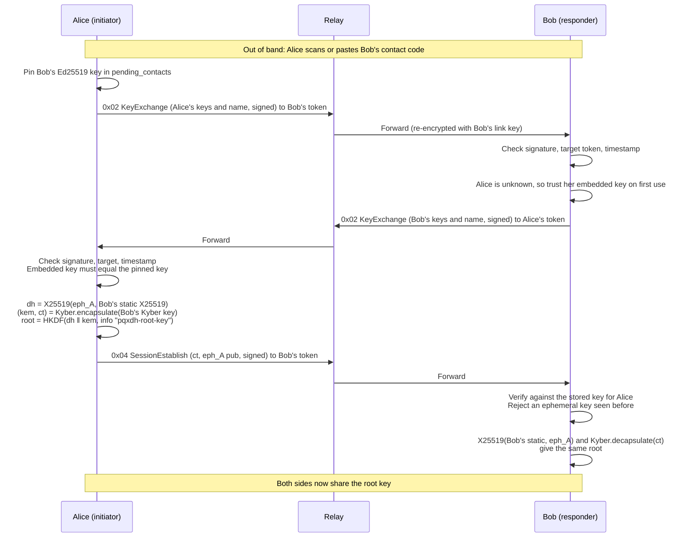

# Cryptography

This doc covers E2E-Messenger's cryptographic protocol as it's implemented in [`code/client`](../code/client) and [`code/server`](../code/server): what each step does, which attacks it defends against, what is still open, and which tests cover it. Packet layouts are in [architecture.md §4](architecture.md#4-wire-format).

This file replaces three older documents: the cryptographic flow write-up (`doable-cryptographic-flow.md`), the security review (`cryptographic_security_review.md`) and the hardening plan (`implementation_plan.md`). Every finding from the review appears here, either as fixed (§8) or still open (§9).

---

## 1. Primitives

| Purpose | Primitive | Crate |
|---|---|---|
| Identity signatures (users and relay) | Ed25519 | `ed25519-dalek` 3 |
| Classical key agreement | X25519 | `x25519-dalek` 2 |
| Post-quantum key encapsulation | Kyber-768 | `pqcrypto-kyber` 0.8 |
| Link and message encryption | XChaCha20-Poly1305 (random 24-byte nonces) | `chacha20poly1305` |
| Key derivation | HKDF-SHA256, salt `e2e-messenger-v1` | `hkdf`, `sha2` |
| Ratchet steps | HMAC-SHA256 | `hmac` |
| Passcode stretching | Argon2id | `argon2` |
| Encryption at rest | SQLCipher (bundled, vendored OpenSSL) | `rusqlite` |

`pqcrypto-kyber` implements CRYSTALS-Kyber, the scheme NIST standardised as ML-KEM in FIPS 203. This crate is the pre-standard version (see §9, L3).

---

## 2. Identities and contact codes

Each user's identity is generated locally by `UserIdentity::generate()` and never leaves the device:

- a random 16-byte **routing token**, the user's address on the relay;
- an **Ed25519** keypair, for signing;
- a static **X25519** keypair, for the classical half of session setup;
- a **Kyber-768** keypair. Its 1184-byte public key is for the post-quantum half of session setup and for PQ injection.

The relay has a single long-term **Ed25519** keypair. It's created on first boot, saved to `server_identity.json`, and its public half is printed to the log. Clients pin that public key: the user pastes it into the desktop app's Connect screen or passes it to the CLI as an argument.

### Contact codes

A Kyber public key is too large for a dependable QR code. So people exchange only a short **contact code**, and the large keys follow over the network. This is the *deferred* key exchange in §4.

```
cryptogram:v1:<routing token, 32 hex>:<Ed25519 public key, 64 hex>
```

The desktop app can show this as a QR code or copy it as text, and can read it by camera scan or paste. Every input path ends in the same `connect_to_peer` call. The Ed25519 key in the code is the **trust anchor**: everything that contact signs later is checked against it. The parsing code is in [`contact_code.rs`](../code/frontend/src/contact_code.rs).

---

## 3. Relay link handshake

Every client sets up an encrypted tunnel to the relay before it sends anything else. The code is `perform_handshake` in [`lib.rs`](../code/client/src/lib.rs) and `handle_request` in [`server/main.rs`](../code/server/src/main.rs).

1. **Client → relay:** the client picks a random 4-byte session ID and makes a fresh ephemeral X25519 keypair. It signs the ephemeral public key with its Ed25519 identity and sends `[0x00 | session_id | eph_pub | ed25519_pub | sig]`.
2. **Relay:** checks the signature against the Ed25519 key that came in the same packet. It makes its own ephemeral X25519 keypair and computes `DH(relay_eph, client_eph)`. From that it derives `link_key = HKDF-SHA256(salt = "e2e-messenger-v1", info = "wireguard-lite-link")`. It signs `client_eph_pub ‖ relay_eph_pub` with its long-term Ed25519 key, stores `session_id → link_key` for one hour, and replies `[0x02 | session_id | relay_eph_pub | sig]`.
3. **Client:** checks the relay's signature against the **pinned** relay pubkey and derives the same `link_key`. If no reply comes within 5 s, the handshake fails with an error.
4. **Sync:** the client sends its own routing token with an empty payload, link-encrypted. The relay maps `token → (address, session_id)`.

From here on, every packet in both directions is `XChaCha20-Poly1305(link_key)` with a random nonce.

**What this proves.**
- The client knows it's talking to the real relay: only the relay can sign the ephemeral keys.
- Because the DH uses only ephemeral keys, a recorded link session stays secret even if a long-term key leaks later.
- The relay learns only that the client holds *some* Ed25519 key. There's no list of allowed clients, so anyone can use the relay (§9, M3).
- The link layer protects against outsiders on the network, **not** against the relay. The relay is untrusted, which is why there's a second, end-to-end layer.

---

## 4. Session setup (deferred key exchange + PQXDH)

The **initiator** is whoever added the contact, by scanning or pasting their code. The other side is the **responder**.



**Checks run on every signed payload** (KeyExchange, SessionEstablish, PQInject, Presence), in `Client::accepts_payload`:

- **Target binding.** `target_token` must equal our own routing token, compared in constant time. That way a payload signed for someone else can't be replayed to us.
- **Freshness.** `timestamp` must be within ±300 s of our clock.

**KeyExchange (`0x02`)**
- The signature is checked against the key embedded in the payload. If we already know the sender's token, that embedded key must **equal** the key we pinned, and the check happens **before** we touch the contact's name or stored Kyber key.
- If the sender is unknown, we're the responder. The request is accepted on first use and answered with our own KeyExchange. We refuse new requests once more than 50 contacts are pending.
- The sender's 32-byte display name rides along inside the signed payload, so the relay can't change it.

**SessionEstablish (`0x04`)**
- Accepted only from a sender already in `pending_contacts`, and checked against **that** key.
- After a valid signature, the ephemeral X25519 key goes into `seen_session_keys`. A second packet with the same key is dropped as a replay. The cache is cleared once it passes 1000 entries.

**Re-running the handshake.** Adding an existing contact again starts a new handshake that **replaces** the old session. There is no other way to reset a session.

**Getting mutual verification.** A one-sided add gives you a working session, but the responder trusted the initiator's key on first use. If both people scan each other's code, each side's second handshake is checked against a pinned key in both directions.

---

## 5. Messaging: the symmetric hash ratchet

There's no Double Ratchet. Messages use an HMAC-SHA256 hash ratchet, and fresh Kyber secrets are mixed in every 5 messages (§5.2). The code is `SymmetricSessionState` in [`lib.rs`](../code/client/src/lib.rs).

### 5.1 Ratchet

```
send_chain₀ = recv_chain₀ = root
message_key = HMAC-SHA256(chain, "message-key")
next_chain  = HMAC-SHA256(chain, "chain-key")
```

Each side keeps a separate **send** chain and **receive** chain, so both people can send at once without getting out of sync.

**Sending:** step the send chain. Encrypt with `XChaCha20-Poly1305(message_key, random nonce)`. Send `0x01 · sender_token · seq_no · nonce · ciphertext`. `seq_no` is the sender's message counter.

**Receiving:** find the session by `sender_token`. This is a direct lookup, so other sessions' ratchets are never touched. Then, comparing `seq_no` with the expected next number `recv_count`:

- `seq_no < recv_count`: use the key stored for that number in the **skip dictionary**, then delete it. If there's no key, it's a duplicate or very late, and it's dropped.
- `seq_no ≥ recv_count`: step a copy of the receive chain forward to `seq_no`, keeping the keys for the numbers it passes. Only if decryption succeeds are the new chain, `recv_count = seq_no + 1` and the skipped keys saved. A failed decryption changes nothing.
- A gap of more than **100** is rejected. The skip dictionary holds at most **500** keys; when full, the oldest are removed first.

Once a message key has been used, it's deleted.

### 5.2 PQ injection

Every 5th message a sender sends (`send_count % 5 == 0`), it also:

1. encapsulates a fresh Kyber secret to the contact's Kyber public key, the one learned from their KeyExchange;
2. mixes it into its **send** chain: `chain = HKDF-SHA256(chain ‖ pq_secret, info "pq-ratchet-inject")`;
3. sends a signed `0x05` PQInject carrying the Kyber ciphertext, right after the message.

The receiver checks the signature against the stored contact key, plus target and timestamp. It drops replays, using a cache of signatures per session that's cleared at 1000 entries. It decapsulates the secret and mixes it into its **receive** chain. After that, anyone who stole an old chain key can't follow the ratchet without the receiver's Kyber secret key.

The receiver mixes the secret into its chain at **whatever position it has reached**. This only works if the PQInject arrives after message 5 and before message 6. If it's lost or arrives out of order, that direction breaks for good (§9, H3).

---

## 6. Presence pings

Desktop clients send each established contact a `0x06` Presence packet every 20 s. That's the header (sender, target, timestamp) plus an Ed25519 signature. Presence is **signed but not encrypted**, and doesn't use the ratchet. It doesn't need to be secret: the relay already sees who sends to which token. Keeping it off the ratchet also means pings don't trigger extra PQ injections.

The receiver accepts a ping only if the signature matches a stored contact key and the target and timestamp checks pass. A valid ping, or any decrypted message, updates `last_seen`. The UI shows a contact as online if it heard from them in the last 45 s.

---

## 7. Local secret storage

### Desktop app (encrypted)

Passcodes are handled in `hash_passcode` and `derive_vault_key` in [`lib.rs`](../code/client/src/lib.rs). The stores are `IdentityStateStore` in [`storage.rs`](../code/client/src/storage.rs) and `ChatHistory` in [`history.rs`](../code/client/src/history.rs).

```
master    = Argon2id(passcode, salt[16], m = 19456 KiB, t = 2, p = 1) → 32 bytes   (never stored)
verifier  = HKDF-SHA256(master, info "e2e-messenger/login-verifier/v1")
vault_key = HKDF-SHA256(master, info "e2e-messenger/vault-key/v1")

passcode.hash = "argon2id$<m>$<t>$<p>$<salt hex>$<verifier hex>"
```

- **Login:** recompute `master` from the stored salt and parameters, then compare `verifier` in constant time. Only on a match is `vault_key` derived.
- Someone who reads `passcode.hash` learns only the verifier. The vault key comes from a different HKDF label, so it can't be derived from the verifier without guessing the passcode, and each guess costs a full Argon2id run.
- `vault_key` is the SQLCipher key for **both** `client_state.sqlite` (identity keys and session state, as one JSON row) and `chat_history.sqlite` (messages). Opening either database runs a test read first, so a wrong key fails straight away.
- The passcode string is wiped (zeroized) as soon as `login` returns. The vault key is kept in a `Zeroizing` buffer that is wiped when it's dropped.
- A `session.lock` file (an OS file lock) stops the same identity being logged in twice.
- There is **no passcode recovery**. Deleting an identity doesn't need the passcode, and is the only way out of a forgotten one.
- **Migration:** if an identity has no encrypted store yet but does have a plaintext `client_state.json`, it's imported into SQLCipher on login and the plaintext file is deleted.

### CLI and relay (plaintext)

The CLI never attaches an encrypted store. `Client::save()` falls back to writing plaintext JSON to `client_state.json`, or to `$E2E_STATE_FILE`. The relay writes its Ed25519 secret to `server_identity.json` in plaintext. See §9, H1.

---

## 8. Hardening history

These issues were found during development, mostly by the original security review, and have since been fixed. Each one has a test (§10).

| Issue | Attack or failure | Fix in the code today |
|---|---|---|
| Replay of handshake payloads | A recorded KeyExchange or SessionEstablish is replayed later | Every signed payload carries a Unix timestamp, checked to ±300 s |
| Identity misbinding | A payload signed for Charlie is forwarded to Bob | Every signed payload carries `target_token`, checked in constant time |
| KEM hijacking | Mallory sends a SessionEstablish claiming to be Alice | SessionEstablish is signed and checked against the sender's **stored** key |
| Self-authenticating `KeyExchangePayload::verify` | The API made it easy to accept a forged key | `verify` takes an explicit key. Known contacts are compared against the pinned key. |
| Forged KeyExchange renaming or re-keying a known contact | A failed check still overwrote the name and Kyber key | The pinned-key check runs before any contact state is touched |
| SessionEstablish replay | Replaying a SessionEstablish forces a fresh session | `seen_session_keys` cache, added to only **after** the signature checks out, bounded at 1000 |
| PQInject replay | Replaying a PQInject corrupts the receive chain | Signature cache per session, bounded at 1000 |
| Desync when both sides send | A single shared chain key broke as soon as both sides sent | Separate `send_chain_key` and `recv_chain_key` |
| Ratchet corruption from trial decryption | The receiver tried every session and stepped the wrong ratchets | `sender_token` in every `0x01` lets the receiver look up the right session directly |
| Lost or reordered messages | One missing message ended the session | Sequence numbers, a skip dictionary and a 100-message window |
| Unbounded memory | Skip dictionary, pending contacts and replay caches could grow forever | Caps of 500, 50 and 1000 |
| Missing HKDF salt | No domain separation between derivations | Every HKDF uses salt `e2e-messenger-v1` plus a distinct label |
| Timestamp overflow | A `u64 → i64` cast could overflow on attacker-chosen values | `abs_diff` |
| Relay identity changed on every restart | Clients had to re-pin the relay's key after each restart | The identity is saved to `server_identity.json` (a Docker volume when in Docker) |
| Mismatched `ed25519-dalek` versions between client and relay | Signatures might not verify | Both use 3.0.0 |
| Relay forwarded inner payloads in plaintext | The link layer gave no protection between relay and recipient | The relay re-encrypts every outbound packet with the recipient's link key |
| Relay never emptied its queues | Messages were delivered again and again until they expired | `outbound_messages()` drains each queue once |
| Relay forwarding misparse | The client misread the first 16 bytes of each forwarded payload | The relay adds a 16-byte zero prefix, which clients strip |
| Plaintext keys on disk (desktop) | Anyone who could read the disk got every key | Argon2id-derived vault key + SQLCipher (§7) |
| `client_state.json` committed to git | Real private keys sat in the repository | Removed from tracking, now in `.gitignore` |
| Dead `utils` crate | Wrong constants (2-byte session ID, port 443) | Crate removed |
| Docs didn't match the code | The docs promised a static-key DH, a Double Ratchet, RaptorQ and a metronome | These docs were rewritten to describe the code as it is |

---

## 9. Open issues

These are known weaknesses in the current implementation. The IDs are only for cross-referencing.

### High

- **H1. Plaintext secrets outside the desktop app.** The CLI's `client_state.json` and the relay's `server_identity.json` hold private keys as plaintext hex. Anyone who can read the file can impersonate that user or the relay.
- **H2. No forward secrecy if long-term keys leak.** A session's root key depends only on the initiator's ephemeral X25519 key and the responder's **static** X25519 and Kyber keys. Every PQ injection is also encapsulated to the receiver's static Kyber key, and those keys are never rotated. Someone who records traffic and later steals a user's static X25519 and Kyber secrets can rebuild every session where that user was the responder, and every injection they received. That exposes the whole conversation. There's no Diffie-Hellman ratchet and no rotating prekeys to limit this.
- **H3. A lost or reordered PQInject breaks that direction for good.** The receiver mixes the PQ secret into its receive chain at its current position. If the PQInject is dropped, arrives before message 5, or arrives after message 6, the two chains diverge. Every later message in that direction then fails to decrypt, silently, until someone re-adds the contact. On a lossy network this is the most likely way a session dies.

### Medium

- **M1. Both directions start from the same chain, and the message header isn't authenticated.** Both chains start at `root`. `sender_token` and `seq_no` aren't covered by the AEAD. Until the first PQ injection, Alice's send key for message *n* equals her receive key for message *n*. So the relay, which can decrypt and re-encrypt the link layer, can rewrite the sender token on one of Alice's first messages and send it back to her, and she'll accept it as a message from Bob. A fix would derive the two chains with labels for each direction, and pass `sender_token ‖ seq_no` as associated data.
- **M2. The responder trusts first use.** An unknown sender's KeyExchange is accepted automatically, with a `[SECURITY WARNING]` log line but no prompt. A real app needs a "message requests" step. Until then, both people should scan each other's code (§4).
- **M3. The relay accepts any client, and session IDs can be taken over.** The link handshake proves only that a client holds *some* Ed25519 key. Session IDs are 4 bytes, chosen by the client and sent in the clear. A new handshake that reuses someone's session ID replaces their link key on the relay. That cuts them off until they reconnect.
- **M4. The relay sees metadata.** The relay decrypts the link layer, so it sees the sender and recipient tokens of every packet, plus payload types, sizes and timing (see [architecture.md §7](architecture.md#7-what-the-relay-can-see)). There's no cover traffic, and the relay logs tokens and IP addresses.
- **M5. Handshake messages are sent once.** If a KeyExchange or SessionEstablish is lost, the contact is left half set up. The initiator thinks the session exists, while the responder still shows the contact as pending. Re-adding the contact retries.
- **M6. PQ injection depends on the sender's message count.** Each direction gets fresh PQ secrets only after its own sender has sent 5 more messages. The receiver can't ask for one, so a quiet direction is rarely refreshed.

### Low

- **L1. Replay caches are cleared all at once.** When `seen_session_keys` or a PQInject replay cache passes 1000 entries, the whole cache is emptied. An old packet could then be accepted again, but only within the ±300 s timestamp window.
- **L2. Skipped keys never expire by time.** Only the 500-key cap removes them, and they're saved to disk with the rest of the session.
- **L3. Kyber isn't the final standard.** `pqcrypto-kyber` is pre-standard CRYSTALS-Kyber, not FIPS 203 ML-KEM. Moving to an ML-KEM implementation would change the wire format of KeyExchange, SessionEstablish and PQInject.
- **L4. No passcode rules.** Only empty passcodes are rejected. Argon2id slows down offline guessing against `passcode.hash`, but a short passcode is still weak.

---

## 10. Tests

Run `cargo test` in each crate. There are 90 tests in all: `code/client` 64, `code/server` 6, `code/frontend` 6 and `code/frontend/src-tauri` 14. CI runs every one of them on each pull request (see the [README](../README.md#building-and-testing)).

### Client protocol and crypto (`code/client`)

| Area | Tests | What they check |
|---|---|---|
| Wire format | `payload_sizes_match_the_wire_format`, `key_exchange_bytes_match_the_original_layout`, `test_key_exchange_serialization`, `test_session_est_serialization`, `test_pq_inject_serialization`, `test_presence_payload_serialization_roundtrip` | Payload sizes (1384, 1224, 1192 and 104 bytes) and byte layout are fixed; parse and sign round trips work |
| Malformed input | `test_edge_case_invalid_packet_sizes`, `test_edge_case_empty_payload_handling` | Wrong sizes, empty payloads and unknown types are rejected without a panic |
| Forged or tampered signatures | `test_edge_case_bad_kx_signature`, `test_edge_case_bad_est_signature`, `test_edge_case_bad_pq_inject_signature`, `test_edge_case_est_wrong_verifier_key`, `test_edge_case_pq_inject_wrong_verifier_key` | A single flipped bit or the wrong signer is rejected |
| Replay and misbinding | `test_edge_case_timestamp_expiration`, `test_edge_case_timestamp_rejection_via_handler`, `test_edge_case_target_misbinding`, `test_edge_case_target_misbinding_via_handler`, `test_edge_case_session_establish_replay_detection`, `test_edge_case_pq_inject_stale_timestamp` | Stale or misaddressed payloads are dropped by `handle_incoming_packet`, and a replayed SessionEstablish is blocked. The two tests without `_via_handler` check only the comparison logic. |
| Hash ratchet | `test_symmetric_hash_ratchet_single_message`, `test_symmetric_ratchet_multiple_messages`, `test_symmetric_ratchet_produces_unique_keys` | The two sides stay in sync, and keys are unique over 100 steps |
| Out of order and limits | `test_edge_case_out_of_order_packets_and_loss`, `test_edge_case_max_skip_dict_exhaustion`, `test_edge_case_duplicate_message_rejection`, `test_concurrent_multi_peer_out_of_order`, `test_edge_case_pending_contacts_exhaustion`, `test_edge_case_seen_session_keys_exhaustion` | Reordered messages, gaps over 100, duplicates, several peers interleaved, and the 50 and 1000 caps |
| PQ injection | `test_pq_inject_triggers_at_interval`, `test_pq_inject_no_trigger_without_kyber_key`, `test_pq_inject_chain_sync`, `test_pq_inject_changes_chain_key` | Fires every 5 messages, keeps both sides in sync, and actually changes the chain |
| Full handshake | `test_full_3way_handshake`, `test_full_handshake_then_pq_inject`, `test_reconnect_after_identity_recreation_creates_independent_session`, `test_key_exchange_propagates_display_name` | End-to-end KeyExchange → SessionEstablish → messages, re-pairing after an identity is recreated, and display names |
| Attacks | `test_attack_session_overwrite_prevention`, `test_attack_no_session_without_pending`, `test_attack_forged_pq_inject`, `test_forged_key_exchange_cannot_rename_or_rekey_a_known_contact` | Mallory can't hijack, open or re-key a session, or rename a contact |
| Presence | `test_presence_ping_marks_peer_online`, `test_presence_ping_expires_after_freshness_window`, `test_chat_message_also_marks_peer_online`, `test_presence_ping_rejects_wrong_target`, `test_presence_ping_rejects_unknown_sender` | Online status, its expiry, and that forged or misaddressed pings are rejected |
| Passcode and vault key | `test_passcode_hash_roundtrip_and_rejection`, `test_passcode_hash_is_salted`, `test_passcode_verify_rejects_malformed_stored_value`, `test_derive_vault_key_matches_only_correct_passcode`, `test_derive_vault_key_is_independent_of_stored_verifier`, `test_derive_vault_key_stable_across_calls` | The Argon2id verifier, and the split between verifier and vault key |
| Storage | `test_storage_save_load_roundtrip`, 5 tests in `storage.rs`, 5 in `history.rs`, `test_forget_contact_removes_session_and_history`, `test_live_and_historical_message_ids_agree` | Plaintext JSON and SQLCipher round trips; a wrong key fails; a corrupt row is an error rather than a fresh identity; history scoping and deletion |

### Relay (`code/server`)

`test_sync_then_forward`, `test_edge_case_invalid_handshake`, `test_edge_case_handshake_mutual_auth_failure`, `test_edge_case_offline_queuing_and_sync`, `test_edge_case_offline_queue_dos_bounds` and `test_edge_case_offline_queue_ttl_expiry` cover the link handshake, sync and forward, offline queueing, the 50-packet cap and TTL expiry.

### Not covered yet

- An end-to-end test through a real relay socket. The client tests strip the link layer with a helper and never go through `code/server`.
- A client rejecting a relay handshake response with a bad signature.
- Loss or reordering of PQInject (H3) and reflected messages (M1). Both would fail today.
