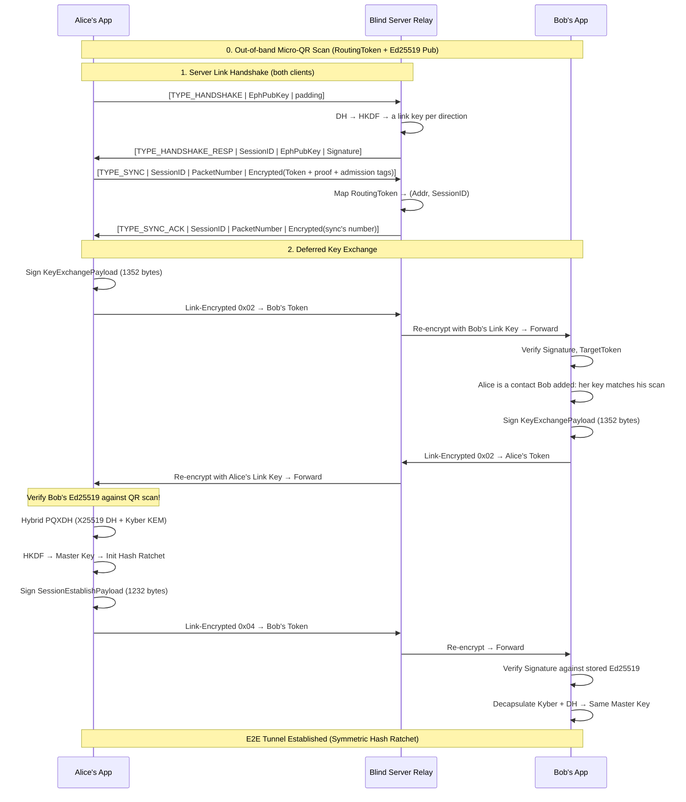

# Doable Cryptographic Flow: MVP Architecture

This document describes the cryptographic architecture of the E2E Messenger MVP as currently implemented in code. It covers the step-by-step flow from local key generation to active messaging, security patches applied during development, and the full unit test report.

---

## 1. Architectural Role Summary

*   **Clients (Alice & Bob)**: Generate all keys locally in memory. Trust is established strictly in person via Micro-QR codes (48 bytes). The clients handle all asymmetric/symmetric cryptography and the Deferred Key Exchange protocol.
*   **Server Relay**: A blind RAM-only router. It has zero knowledge of User IDs or E2E keys. It uses a "WireGuard-Lite" X25519 Link Handshake to establish ephemeral link keys with clients, one for each direction. It reads an unencrypted 4-byte Session ID (which it picks itself, in the handshake) to identify the link's keys, decrypts the outer shell, reads the 16-byte Routing Token, re-encrypts the inner payload with the recipient's link key, and forwards it to the address that link has proven it's at. Every link packet is numbered, and each number is taken in once, so nothing captured off the wire can be replayed. Every forwarded packet waits in a RAM queue (bounded to 2 MiB per recipient for its contacts' packets, refusing new packets once full, plus 64 KiB for everyone else's, and kept up to 7 days) until the recipient acknowledges it, and is resent until then, so a recipient that's offline, asleep or behind a changed NAT mapping still gets it once it syncs again.

---

## 2. Phase 1: Local Setup & In-Person Trust (Micro-QR)

Because ML-KEM-768 public keys are 1184 bytes (far too large for a reliable QR code), this MVP uses a **Deferred Key Exchange**: the camera scan only transfers a minimal identity payload, and the bulk cryptographic keys are exchanged in-band over the network.

1.  **Local Key Generation** (`UserIdentity::generate()`): The Rust core generates three long-term keypairs:
    *   **Ed25519** (`ed25519-dalek`): For identity signing and payload authentication.
    *   **X25519** (`x25519-dalek`): For classical Diffie-Hellman key exchange.
    *   **ML-KEM-768** (`pqcrypto-kyber`): For post-quantum key encapsulation.
    *   A random 16-byte **Routing Token** is also generated to identify this client on the relay.
2.  **Micro-QR Code Display**: The UI displays a QR code containing only the 16-byte `RoutingToken` + 32-byte `Ed25519 VerifyingKey`. Total: **48 bytes**.
3.  **Scanning & Trust**: Alice scans Bob's QR code. She now has a cryptographically authenticated binding between Bob's Routing Token and his Ed25519 identity.

---

## 3. Phase 2: Server Link Handshake

Before any E2E communication can occur, each client must establish a link-layer encrypted tunnel with the server.

The formats below live in `code/relay-link`, which both the client and the server build on.

1.  **Client Boot**: The client generates an ephemeral X25519 keypair and sends a Handshake packet `[TYPE_HANDSHAKE | EphX25519Pub | 96 zero bytes]` to the server. The handshake doesn't say who the client is (the server couldn't check a client's identity key against anything anyway); the client proves what matters, that it owns its routing token, in its sync (step 4). The padding keeps the init bigger than the reply, so a handshake sent with someone else's address can't make the server an amplifier.
2.  **Server Processing**: The server performs `DH(ServerEphPriv, ClientEphPub)` and derives the link's two keys, one per direction, via `HKDF-SHA256` with salt `"e2e-messenger-v1"` and info strings `"e2e-messenger/link/v2/to-relay"` and `"e2e-messenger/link/v2/to-client"`. It gives the link a random Session ID that no live link has, remembers the address the handshake came from, and returns `[TYPE_HANDSHAKE_RESP | SessionID | ServerEphPub | ServerEd25519Sig]`, the signature covering both ephemeral keys and the Session ID. The Session ID is in the clear on every packet, so the server picks it: nobody who sees one can claim that link. A link nobody syncs on within a minute is dropped, and the server keeps at most 100,000 links, refusing handshakes past that, so a flood of handshakes can't run it out of memory.
3.  **Client Completion**: The client verifies the server's signature using the server's static identity, which the app was built with, performs DH with the server's ephemeral public key, and derives the same two keys.
4.  **Sync Packet**: The client proves it owns its Routing Token (a hash of a token key, which signs a value derived from the link's keys) so the server can map `RoutingToken → (SocketAddr, SessionID)` for routing, and registers one 8-byte admission tag per contact (see below). A link carries one token for good. Clients resend the sync every 15 seconds to keep their NAT mapping (and the server's record) alive, and the server acks each one (`TYPE_SYNC_ACK`). A sync only takes effect from the address the link has proven it's at; from any other address (the phone's NAT mapping changed) the server sends a path challenge there, sealed with the link key, and moves the link only once the answer comes back over the link from that address. A token's sync on a new link retires its old link, however long ago that was last used.
5.  **Reconnecting**: A client whose sync goes unacked for 10 seconds takes its link to be gone (the server restarted, or dropped a link idle for an hour) and does the handshake again on the same socket, then syncs on the new link. So a server restart, or a phone that slept, doesn't leave anyone cut off until they restart the app.
6.  **Admission**: Each pair of contacts derives an 8-byte tag per direction from their static X25519 keys (`HKDF(DH(X25519_A, X25519_B), "e2e-messenger/admission/v1" || sender || recipient)`), which only they can compute. A recipient registers its contacts' tags in its sync, and senders put the tag on their packets (`TYPE_ADMITTED_DATA`). Once a recipient has registered tags, packets without one (including from anyone who only knows its token from its QR code) share a 64 KiB queue of their own, so they can't crowd out its contacts' messages. Queues for recipients that haven't registered tags (because they haven't synced since the server started, or because nobody owns the token) share a 64 MiB budget between them, so made-up tokens can't take the server's memory either. The server keeps up to 100,000 recipients' tags; past that, a new recipient's packets share one queue, as before tags existed.
7.  **Delivery & Acks**: The server gives each queued packet a random 16-byte Delivery ID and sends it to the recipient in the 16-byte prefix of the forwarded envelope (all zeros on a dummy packet). The recipient handles the packet, then replies with an Ack `[TYPE_ACK (3) | SessionID | PacketNumber | link-encrypted: own RoutingToken | DeliveryID...]`, and the server drops the packet from its queue. Only the link session the token last synced from can ack it. Until then the server resends it after 2s, 4s, 8s… (at most 60s apart), and straight away when the recipient syncs from a new address or after more than 30 seconds of silence (it was asleep). Resends are safe: the client remembers recent Delivery IDs, so a repeat is only acked again, never handled twice.

All subsequent packets are wrapped in `ChaCha20-Poly1305` link encryption, with the key for the direction they're going, and the packet type, Session ID and packet number authenticated as associated data. The packet number is the nonce: each end numbers what it sends, and takes each number in at most once, keeping a 1024-packet window for reordering. So a captured packet replayed from anywhere is refused, and a packet the server sent can't be bounced back to it as the client's. A client numbers message bursts apart from everything else (they're sealed at once but paced out over a few seconds), so the two don't push each other out of the window.

---

## 4. Phase 3: Session Initialization (Deferred Key Exchange)

The 3-way handshake exchanges the massive Post-Quantum keys in-band, authenticated by Ed25519 signatures.

1.  **KeyExchange Request (0x02)**: Alice sends a `KeyExchangePayload` (1352 bytes) to Bob's Routing Token containing: `[AliceRoutingToken | BobRoutingToken | Timestamp | Ed25519Pub | X25519Pub | KyberPub | Ed25519Signature]`. The signature covers all preceding fields, binding the payload to the intended recipient and preventing replay.
2.  **KeyExchange Response (0x02)**: Bob receives Alice's request, verifies the Ed25519 signature, checks the `target_token` matches his own identity, and checks Alice is a contact he added himself, with the key he scanned. Then he sends his own `KeyExchangePayload` back to Alice. A KeyExchange is taken in however long it waited at the relay (add IDs, below, tell an old one from a current one); only the display name in it is ignored once its timestamp is more than 300 seconds off, as she may have renamed herself since.
3.  **Verification**: Alice receives Bob's response and **verifies his Ed25519 signature against the key she got from the physical QR scan**. This is the critical trust anchor — it mathematically proves the massive Kyber/X25519 keys were sent by the real Bob.
4.  **SessionEstablish (0x04)**: Alice performs the Hybrid PQXDH handshake:
    *   Generates an ephemeral X25519 keypair and computes `DH(AliceEphPriv, BobX25519Pub)`.
    *   Encapsulates a secret against Bob's Kyber public key: `encapsulate(BobKyberPub) → (PQ_SharedSecret, KyberCiphertext)`.
    *   Derives the Master Key: `HKDF-SHA256(DH_Secret || PQ_Secret, salt="e2e-messenger-v1", info="pqxdh-root-key")`.
    *   Sends a `SessionEstablishPayload` (1232 bytes) containing: `[AliceToken | BobToken | Timestamp | KyberCT | EphX25519Pub | AliceAddId | BobAddId | Ed25519Signature]`.
5.  **Bob Accepts**: Bob verifies the signature against Alice's stored Ed25519 key, decapsulates the Kyber ciphertext, performs the same hybrid derivation, and arrives at the identical Master Key. He confirms with a KeyExchange naming the session, and only then does Alice use it. The E2E tunnel is now established.

In the implementation both people add each other (scanning each other's QR code), the contact with the lower routing token always establishes, and the KeyExchange carries whether the sender has the target's keys, its *add ID* for the target, and which session it holds. A client gives a contact a new add ID, from a counter that only goes up, whenever it adds them from scratch (the first time, or after removing them). A SessionEstablish names the pair of add IDs it was made for. So the establisher offers the session it already has (re-signed) however often it's asked, rather than a new one each time; both sides recognise a message from before either last removed the other; and adding the contact again from either side picks the setup up wherever it stopped. Each step of the setup is a single UDP packet to the relay, which nothing would resend, so until a contact is connected, the client sends its KeyExchange to them again: 30 seconds after adding them, then twice as long each time, up to 8 times, starting over whenever they reply, and straight away after reconnecting to the relay. Nothing is promised to a contact that couldn't be saved first: an establisher doesn't offer a session it couldn't save, and a responder doesn't take in or confirm one.

---

## 5. Phase 4: Active Messaging

Once the session is bootstrapped, ongoing messaging uses a **Symmetric Hash Ratchet** (HMAC-SHA256) — not the Signal Double Ratchet. This was a deliberate simplification.

1.  **Symmetric Ratchet (Split Send/Recv) & Skip Dictionary**: Each direction maintains independent state (`send_chain_key` and `recv_chain_key`) to prevent cross-talk or desynchronization in two-way conversations:
    *   `MessageKey = HMAC-SHA256(SendChainKey, "message-key")`
    *   `NextSendChainKey = HMAC-SHA256(SendChainKey, "chain-key")` (and similarly for `RecvChainKey` on decryption).
    *   The old Chain Key is destroyed, but unused Message Keys are temporarily stored in a **Skip Dictionary** (up to 100 keys ahead) to handle out-of-order delivery gracefully.
2.  **Message Encryption**: The plaintext is encrypted with `XChaCha20-Poly1305` using the Message Key. A fresh 24-byte random nonce is generated per message. The sender's 8-byte sequence number (`seq_no`) is included in the E2E payload structure.
    *   **Chunking & padding**: before encryption, a message is split into chunks of up to 1011 bytes (`[kind | 8-byte message id | index | count | data]`, at most 16 chunks, so messages up to 16,176 bytes), and each chunk is padded to a fixed 1024-byte block (`[2-byte length | chunk | zeros]`). Each chunk is its own ratcheted message, so every chat packet to a contact (an FEC symbol carrying part of a message) is exactly 1146 bytes on the wire (with its admission tag) — under the 1232-byte UDP payload that avoids IP fragmentation on any path — and neither the relay nor a network observer can read a message's length beyond its chunk count. The receiver reassembles chunks (in any order) before anything reaches the inbox or chat history; incomplete messages are dropped after 5 minutes.
3.  **Periodic KEM Injection (PQ Ratchet)**: To provide continuous Post-Quantum secrecy without full session resets, a new Kyber encapsulation is performed against the peer's stored Kyber public key every 5 messages (counted in ratchet steps, i.e. chunks; checked once per message, so the inject is always sent after a message's last chunk and never between two). The new PQ shared secret is mixed independently into the respective Chain Key via HKDF. The Kyber ciphertext is sent as a `0x05 PQInjectPayload` (1200 bytes), which carries `applies_at`: the sender's `send_count` when it mixed the secret in. The receiver mixes it in at exactly that position — straight away if its receive chain is already there, otherwise held until the messages before it arrive — so the inject can arrive before or after the messages around it, and any number of times: a copy for a position already reached is ignored. That position check replaces both a signature replay cache and the 5-minute timestamp check (which would have dropped an inject queued at the relay while the recipient was offline for longer, breaking the session). To stop an inject being replayed into a *later* session with the same peer, where positions restart from 0, its signature also covers a session binding (`HMAC(root_key, "pq-inject-session-binding")`) that is never sent, so it only verifies on the session it was made for. Every packet of a message, inject included, is therefore safe to resend.
4.  **Packet Structure**: `[0x01 | 16-byte SenderToken | 8-byte SeqNo | 24-byte Nonce | E2E Ciphertext of one padded chunk]`, wrapped in link encryption. The 16-byte `SenderToken` enables O(1) direct session lookup, preventing speculative ratchet corruption.
5.  **Decryption**: The receiver extracts the `SenderToken` to locate the correct session, then uses the `seq_no`. If it's a previously skipped message, it retrieves the key from the Skip Dictionary. If it's a future message, it fast-forwards the `recv_chain_key` (up to 100 steps) and stores the intermediate skipped keys.

---

## 6. Network Sequence Diagram



---

## 7. Nested Packet Structure

```
Raw UDP Datagram
├── [1 byte]  Packet Type (0=Handshake, 1=Data, 2=Handshake response, 3=Ack, 4=Sync, 5=Admitted data, 6=Path challenge, 7=Path response, 8=Sync ack)
├── [4 bytes] Link Session ID (unencrypted, identifies the link's keys)
├── [8 bytes] Packet Number (unencrypted: the nonce, and each is taken in once)
└── ChaCha20-Poly1305 Link-Encrypted Envelope (the header above is its associated data)
    ├── [16 bytes] Routing Token (read by server for forwarding), then on
    │              admitted data an 8-byte admission tag;
    │              on packets the server forwards, the Delivery ID instead
    └── Inner E2E Payload
        ├── [1 byte] Inner Type (0x00=Relay dummy, 0x01=Msg, 0x02=KeyExchange, 0x04=SessionEstablish, 0x05=PQInject, 0x07=FEC symbol)
        └── Type-specific payload (E2E encrypted or signed)
            ├── Msg (0x01): [16 bytes SenderToken] + [8 bytes SeqNo] + [24 bytes Nonce] + [Ciphertext]
            │   └── Ciphertext decrypts to a 1024-byte padded block:
            │       [2 bytes Length] + [Chunk] + [Zeros]
            │       Chunk = [1 byte Kind] + [8 bytes MessageId] + [1 byte Index] + [1 byte Count] + [≤1011 bytes Data]
```

---

## 8. Security & Vulnerabilities Report

### Vulnerabilities Discovered & Patched

| # | Vulnerability | Attack Vector | Fix Applied |
|---|---|---|---|
| 1 | **Replay Attack** | Compromised server records Alice's `KeyExchange` and replays it to Bob days later | Added 8-byte monotonic Unix timestamp to `KeyExchange` and `SessionEstablish`. A SessionEstablish outside ±300s is answered with a fresh request instead. Add IDs now tell an old `KeyExchange` from a current one, so one that waited at the relay is still taken in (only its display name isn't), and a replayed copy changes nothing. Link packets are numbered, so the relay and clients refuse any copy of one they've taken in. |
| 2 | **Identity Misbinding** | Mallory forwards Alice's signed `KeyExchange` to Bob (Alice intended it for Charlie) | Added `target_token` to all signed payloads. Signature binds sender's keys to recipient's Routing Token. |
| 3 | **Unauthenticated KEM Hijacking** | Mallory encapsulates a Kyber secret against Bob's key and sends a fake `SessionEstablish` claiming to be Alice | `SessionEstablish` is now signed by sender's Ed25519 key. Bob verifies against Alice's stored key before accepting. |
| 4 | **Server Forwarding Plaintext** | Server stored raw inner payloads and forwarded them without re-encrypting with recipient's link key | Server now re-encrypts all outbound messages with recipient's `XChaCha20-Poly1305` link key before sending. |
| 5 | **Plaintext Dummy Packets** | Server sent cleartext dummy packets (`b"dummy_padding_to_look_real"`), making them trivially distinguishable from real traffic | Dummy packets are now random 64-byte payloads encrypted with recipient's link key, indistinguishable from real traffic. |
| 6 | **Session Reset DoS** | Attacker replays intercepted `SessionEstablish` packets to force redundant derivations | Originally a `seen_session_keys` cache. Now each SessionEstablish names the add IDs it was made for, and is only taken in for the recipient's current one; a copy of the session it already has is only confirmed again. (The cache also blocked the establisher's legitimate re-offer of the same session.) |
| 7 | **Bidirectional Desync** | A single shared `chain_key` meant that Alice sending a message would desync Bob's sending state, permanently breaking the session if both parties sent messages. | Split `chain_key` into independent `send_chain_key` and `recv_chain_key` to maintain separate bidirectional state. |
| 8 | **Ratchet Corruption via Speculative Decryption** | E2E messages did not contain sender identities, forcing receivers to brute-force decrypt against all sessions. This speculatively advanced ratchets, permanently corrupting innocent sessions. | Prepend 16-byte `SenderToken` to the E2E `0x01` message payload. Receiver now performs $O(1)$ direct session lookup without touching other sessions. |

### Unit Test Report (35 tests, all passing)

#### Serialization & Signature Tests
| Test | Description |
|---|---|
| `test_key_exchange_serialization` | Generates a `KeyExchangePayload`, serializes to 1352 bytes, deserializes, and verifies the Ed25519 signature round-trips correctly. Asserts `target_token` and `routing_token` are preserved. |
| `test_session_est_serialization` | Generates a `SessionEstablishPayload`, serializes to 1224 bytes, deserializes, and verifies the Ed25519 signature. Asserts `routing_token` and `target_token` are preserved. |
| `test_pq_inject_serialization` | Generates a `PQInjectPayload`, serializes to 1200 bytes, and verifies the Ed25519 signature and `applies_at` correctly round-trip. |

#### Edge Case: Malformed Packets
| Test | Description |
|---|---|
| `test_edge_case_invalid_packet_sizes` | Feeds invalid byte arrays to deserialization for all payload types (`KeyExchange`, `SessionEstablish`, `PQInject`). All must return `Err` without panicking. |
| `test_edge_case_empty_payload_handling` | Feeds empty payloads, unknown type bytes (`0xFF`), and undersized `0x01` payloads to `handle_incoming_packet`. Verifies graceful `Ok(None)` or `Err` without crashes. |

#### Edge Case: Tampered Signatures
| Test | Description |
|---|---|
| `test_edge_case_bad_kx_signature` | Flips a single bit in the Kyber key region of a serialized `KeyExchangePayload`. `verify()` must return `Err`. |
| `test_edge_case_bad_est_signature` | Flips a single bit in the signature region of a serialized `SessionEstablishPayload`. `verify()` must return `Err`. |
| `test_edge_case_bad_pq_inject_signature` | Corrupts a byte in a serialized `PQInjectPayload`. `verify()` must return `Err`. |
| `test_edge_case_est_wrong_verifier_key` | Signs a `SessionEstablish` with Alice's key but attempts verification with Bob's key. Simulates Mallory forging a packet. Must return `Err`. |
| `test_edge_case_pq_inject_wrong_verifier_key` | Simulates Mallory forging a `PQInject` packet. Must return `Err`. |

#### Edge Case: Server Offline Routing & Queuing
| Test | Description |
|---|---|
| `test_edge_case_offline_queuing_and_sync` | Asserts that messages sent to an offline receiver are securely queued in RAM, sent as soon as the receiver boots, handshakes, and sends a Sync packet, and only leave the queue once the receiver acks them. |
| `test_edge_case_offline_queue_dos_bounds` | Spams more packets than fit to an offline routing token. Asserts the server strictly bounds the queue to 2 MiB, refusing new packets and keeping the oldest, to prevent RAM exhaustion (DoS protection). |
| `stores::tests::*` | Unacknowledged packets are resent with backoff; acks only count from the recipient's own link session; a sync from a new address or after silence resends at once; resend delays double up to 60s; a link in use isn't swept, one nobody syncs on goes within a minute; a link carries one token; a token's new link retires its old one even after its metadata expired; the link and admission tables are capped; queues for recipients without tags share one budget. |
| `test_replayed_packets_are_refused`, `test_a_forwarded_packet_bounced_back_is_refused` | A copy of a sync or data packet the relay took in already is refused from any address, without a challenge or a second queued copy; a packet the relay sent can't be bounced back to it. |
| `test_handshakes_are_refused_while_the_link_table_is_full` | Past the link table's cap, handshakes are refused instead of growing it. |
| `test_relay_packet_is_acked_and_resend_handled_once` (client) | A forwarded packet is handled and acked; a resend (sealed afresh by the relay) is only acked again, and a copy of the very same packet isn't taken in at all. |
| `test_keepalive_redoes_the_handshake_once_syncs_go_unacked` (client) | Once a sync has gone unacked for 10 seconds, the keepalive starts a new handshake; only the pinned relay's reply to it completes it, and the client syncs on the new link and resends KeyExchanges at once. |
| `test_edge_case_offline_queue_ttl_expiry` | Enqueues a message with an expired TTL. Asserts the background sweeper safely destroys the expired message and cleans up the empty queue HashMap entry. |

#### Edge Case: Replay & Misbinding
| Test | Description |
|---|---|
| `test_edge_case_timestamp_expiration` | Sets a payload's timestamp to 10 minutes in the past. Asserts the time differential exceeds the 300-second threshold. |
| `test_stale_key_exchange_from_a_contact_still_carries_the_setup_on` | Sends a correctly re-signed KeyExchange whose timestamp is stale (it waited at the relay). Asserts the contact's keys are taken in and answered, but not the name in it, and that one addressed to someone else is dropped. |
| `test_setup_completes_when_the_second_key_exchange_arrives_late`, `test_resent_key_exchange_gets_past_lost_packets` | The second person's KeyExchange arrives late, or every first-round KeyExchange is lost: the setup completes either way. |
| `test_adding_your_own_code_is_refused` | Adding your own code is refused, and a packet claiming to come from you is dropped. |
| `test_edge_case_target_misbinding` | Generates a `KeyExchange` intended for Charlie (`0xCC`). Asserts that Bob (`0xBB`) correctly detects the `target_token` mismatch. |
| `test_edge_case_target_misbinding_via_handler` | Sends a misbinding KeyExchange through `handle_incoming_packet`. Asserts the handler drops it and does NOT create a pending contact. |

#### Symmetric Hash Ratchet
| Test | Description |
|---|---|
| `test_symmetric_hash_ratchet_single_message` | Alice encrypts "Hello Bob!" with the ratchet, simulates server stripping link encryption, Bob decrypts. Asserts chain keys remain in sync. |
| `test_symmetric_ratchet_multiple_messages` | Advances two independent ratchet states 10 times. Asserts every message key and chain key match at each step. |
| `test_symmetric_ratchet_produces_unique_keys` | Advances a single ratchet 100 times. Asserts every message key is unique (no collisions in a HashSet). |

#### PQ Ratchet Injection Tests
| Test | Description |
|---|---|
| `test_pq_inject_triggers_at_interval` | Asserts a `PQInject` packet is generated exactly on every 5th message, and not otherwise. |
| `test_pq_inject_no_trigger_without_kyber_key` | Asserts `PQInject` is not triggered if the peer's Kyber public key is missing from session state. |
| `test_pq_inject_chain_sync` | Verifies that after a PQ injection, both sides' chain keys remain identical. |
| `test_pq_inject_changes_chain_key` | Asserts that injecting PQ entropy actually changes the chain key from what a pure hash ratchet would produce. |

#### Message Padding & Chunking
| Test | Description |
|---|---|
| `test_chat_packets_are_fixed_size_and_unpadded_on_receive` | Sends messages from empty up to one full chunk, one packet per chunk (the test-only path without FEC). Every packet is 1142 bytes and Bob receives the original text. |
| `test_long_message_split_and_reassembled_out_of_order` | Sends a 3-chunk message with an emoji straddling a chunk boundary, delivered in reverse. Nothing reaches the inbox until the last chunk; then the exact text does. |
| `test_pq_inject_sent_once_after_last_chunk` | A 12-chunk message crossing three PQ intervals produces exactly one inject, after the last chunk; chain keys stay in sync and the next message decrypts. |
| `test_oversized_message_rejected_without_advancing_ratchet` | A message one byte over the 16,176-byte limit is rejected with a "too long" error, leaving `send_count` and the chain key untouched. |
| `test_unpadded_message_from_older_client_is_dropped` | An authentic but unpadded message (as a pre-padding client sends) is dropped; the ratchet stays in sync for the next message. |
| `padding::tests::*`, `chunks::tests::*` | Pad/unpad round trips and rejection of malformed blocks; split sizes at chunk boundaries; reassembly in any order, duplicate chunks, malformed headers, inconsistent counts, expiry, and the per-sender cap on incomplete messages. |

#### PQ Refresh Ordering & Resends
| Test | Description |
|---|---|
| `test_pq_inject_arriving_early_is_held_until_its_position` | The inject overtakes the last message before it. It's held, applied once that message arrives, and every message decrypts. |
| `test_pq_inject_arriving_late_recovers_when_message_is_resent` | A message overtakes the inject it depends on and can't decrypt yet, without disturbing state; its resent copy decrypts once the inject arrives. |
| `test_resent_pq_inject_and_message_copies_are_ignored` | Repeated copies of the inject and of already-received messages change nothing: each message is delivered once and the chains stay in sync. |
| `test_several_pq_injects_ahead_of_out_of_order_messages` | Two injects arrive before any message, newest first, then messages out of order across both injects. All decrypt. |
| `test_pq_inject_accepted_long_after_it_was_sent` | An inject whose timestamp is 10 minutes old (e.g. queued at the relay while offline) is still applied. |
| `test_pq_inject_replayed_into_a_new_session_is_rejected` | An inject from an earlier session with the same peer fails verification against the new session's binding and is not held. |

#### Full Integration & Attack Simulation
| Test | Description |
|---|---|
| `test_full_3way_handshake` | Simulates the complete Alice↔Bob handshake: QR scan → KeyExchange → KeyExchange reply → SessionEstablish. Verifies both clients derive identical root keys and chain keys. |
| `test_full_handshake_then_pq_inject` | Full end-to-end integration: 3-way handshake followed by 5 messages and a PQ inject, verifying chain keys remain perfectly synchronized. |
| `test_attack_session_overwrite_prevention` | Mallory creates a `SessionEstablish` signed with her own key but spoofs Alice's `routing_token`. Bob verifies the signature against Alice's stored Ed25519 key — verification fails, session is NOT established. |
| `test_attack_no_session_without_pending` | A valid `SessionEstablish` arrives from an unknown sender (not in `pending_contacts`). Bob rejects it — no session is established. |
| `test_attack_forged_pq_inject` | Mallory sends a `PQInject` spoofing Alice. Signature verification fails and Bob's chain key is not altered. |

#### Out-of-Order, Bounds & DoS Protection
| Test | Description |
|---|---|
| `test_edge_case_out_of_order_packets_and_loss` | Delivers 3 messages out of order (msg3 first, then msg1, msg2). Verifies skip dictionary correctly buffers and delivers all messages. |
| `test_edge_case_max_skip_dict_exhaustion` | Attempts to decrypt a message with seq_no 150 (gap > 100). Verifies the ratchet rejects it and recv_count stays at 0. |
| `test_edge_case_duplicate_message_rejection` | Delivers msg1 out of order (skip_dict), then delivers msg0 from skip_dict, then replays msg0. Verifies replay is rejected (returns None). |
| `test_edge_case_pending_contacts_exhaustion` | Floods 55 KeyExchanges to a single client. Verifies pending_contacts is bounded to 51 (50 + 1 already accepted before the check). |
| `test_edge_case_session_establish_flood_keeps_one_session` | Floods 100 SessionEstablish packets from a contact. Verifies one session remains and nothing grows with the flood. |
| `test_repeated_session_establish_changes_nothing` | Delivers the same SessionEstablish again after the session is in use. Verifies it's only confirmed again, with the session untouched. |
| `test_messages_from_before_a_re_add_are_ignored` | A KeyExchange and a SessionEstablish from before one side removed and re-added the other are ignored, and the new session stands. |
| `test_storage_save_load_roundtrip` | Creates a Client with sessions, pending contacts, add IDs and a pending session offer. Saves to JSON, loads back, and verifies all of it survives round-trip. |
| `test_concurrent_multi_peer_out_of_order` | Simulates receiving highly interleaved and out-of-order packets from multiple peers simultaneously. Asserts $O(1)$ SenderToken lookup routes to the correct session and skip dictionaries handle the disorder cleanly without advancing the wrong ratchets. |

### Known Issues & Acceptable MVP Compromises

1.  **Connection requests aren't verified**: A `KeyExchange` from someone Bob hasn't added is dropped, and only its token is listed, so the app can ask him to scan their code (which is the trust step). Nothing proves the requester owns that token until he does.
